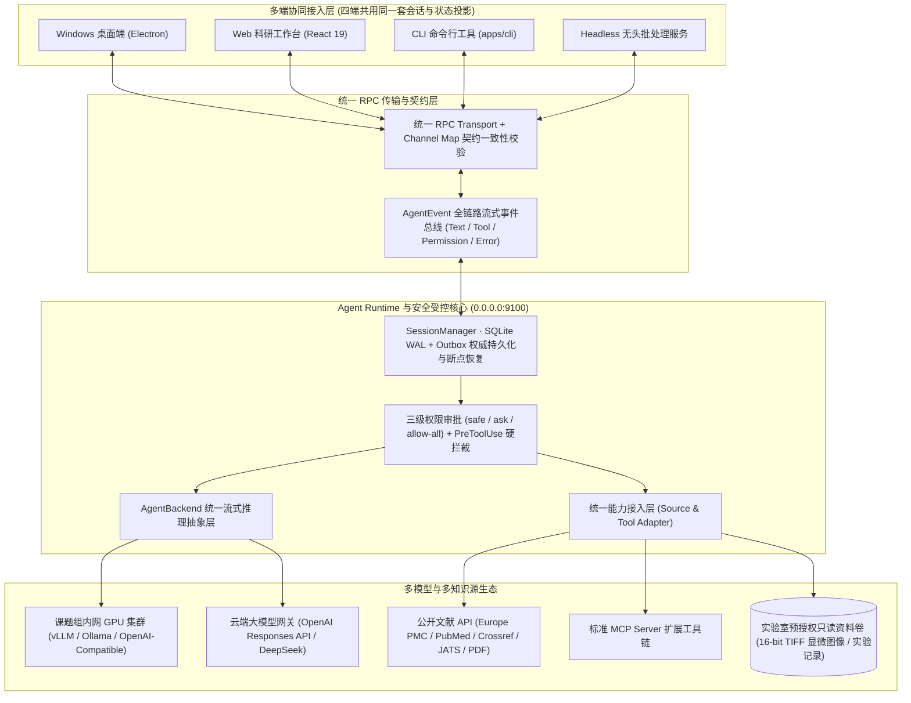

<div align="center">


### 面向医药研发与医学团队的私有化多端 Agent 协同与可追溯证据平台

**多端同源协同 (Desktop / Web / CLI / Headless) · 本地与云端模型无缝切换 · MCP/API/本地知识源统一接入 · PreToolUse 安全审批 · 双环评测迭代**

[](https://gtdd123.github.io/bio-evidence/)


-22c55e?style=flat-square)


[**🌐 在线交互体验 (Live Demo)**](https://gtdd123.github.io/bio-evidence/) · [界面与交互预览](#preview) · [核心架构与设计](#architecture) · [可观测与安全边界](#security) · [评测与双环迭代](#evaluation) · [生产部署指南](#deployment)

</div>

**BioEvidence** 是面向生物医药研发与医学临床研究团队自研的**可私有化部署多端 Agent 协同平台**。针对医学研发场景中“AI 工具碎片化、实验与临床数据高度敏感、多人协作易串线、长文献综述引用易幻觉”的核心痛点，平台在底层构建了统一的 **Agent Runtime、多端 RPC 会话核心、统一能力接入层（MCP / API / 本地受控资料）与 `PreToolUse` 安全拦截器**，实现 **Windows 桌面端（Electron）、Web 端、CLI 与无头服务（Headless Server）** 四端共用同一套会话状态与模型连接核心——**同一份 Agent 逻辑多端复用、换端续跑不重来、多人协作不串线、全过程可审计可回溯**。

> **在线体验与生产部署说明**：生产环境后端与实验数据库运行于课题组受控内网（支持 Docker / HTTPS 集群私有化部署）；外部访客可直接点击上方 **[🌐 在线交互体验 (Live Demo)](https://gtdd123.github.io/bio-evidence/)** 体验免后端的完整科研工作台交互流程。

<a id="preview"></a>
## 界面与交互预览


*实机交互录屏：展示顶部模型路由切换（OpenAI GPT / DeepSeek / 课题组内网 GPU）、三级安全模式（`Safe` / `Ask` / `Allow-All`）与 `PreToolUse` 实时审批、可折叠 `AgentEvent` 执行轨迹、原文段落精确锚定及多帧显微图像预览。*


<details>
<summary><strong>查看受控实验资料中心、16-bit 多帧 TIFF 选帧与 ROI 实验批注视图</strong></summary>


*零信任受控资料中心：目录由服务端 `material-grants.json` 显式预授权并与项目空间绑定，原生支持多帧显微图像（16-bit TIFF / PNG）流式选帧预览、多通道对照与实验批注，严防私有实验资产越权外发。*

</details>

<a id="architecture"></a>
## 核心架构与工程设计



### 1. 运行时与多端同源复用（Runtime & Multi-Client Reuse）

- **本地与云端模型无缝切换（`AgentBackend` 统一抽象）**：针对医学数据敏感、课题组需在“内网私有化推理”与“云端大模型”间灵活切换的诉求，平台抽象了 `AgentBackend` 统一流式事件接口，原生内置 **OpenAI 官方 Responses API**、**DeepSeek 官方 HTTPS Chat Completions** 以及 **课题组内网 GPU 节点（Lab Intranet OpenAI-Compatible 端点）** 适配器——**切换本地或云端模型仅需在顶部路由栏或配置中切换连接，上层业务与工具链零改动**。
- **桌面、Web、CLI 与无头服务续接同一份会话**：科研人员常在桌面端查文献、网页端接着同一段调研。平台通过**统一 RPC 传输层 + `Channel Map` 契约一致性测试**，配合服务端 SQLite WAL + Transactional Outbox 投影机制，让桌面、Web、CLI 与无头服务复用同一套会话与模型连接核心，**换端不重来、协议漂移在开发期即被契约测试拦截**。
- **文献库、MCP 与内部资料统一接入**：将公开文献库（Europe PMC / PubMed / JATS XML / PDF）、标准 **MCP 工具服务**以及实验室内部只读资料库统一封装为 Agent 工具接口，凭据由服务端 `CredentialManager` 原子加密托管，**接入新知识源仅需新增一个适配器**。

<a id="features"></a>
### 2. 生物医药证据链与多模态科研工作区

| 文献检索与确定性快照 | 可追溯证据链与防幻觉校验 | 实验室受控资料与多端协同 |
| --- | --- | --- |
| **多源文献深度解析**：支持 Europe PMC / PubMed / PDF / JATS XML 快照抓取，精确记录定位器、页码与 UTF-16 字符级选区偏移 | **原文级锚定与版本化修订**：每条科研论断（Evidence Item）精确绑定原文快照片段，每次修订生成不可变 Revision 历史 | **多租户空间与 RBAC 隔离**：支持个人空间与课题组共享项目，严格隔离读写与管理职责 |
| **16-bit TIFF 多帧显微图像预览**：支持实验室只读目录挂载、12 帧以上多通道显微图像在线选帧预览与 ROI 实验批注 | **结构校验与人工复核双轨解耦**：自动执行引用结构校验（Structural Citation Check），并与科研人员显式核对（Human Review）状态解耦 | **多格式合规导出**：在权限审批通过后，支持一键导出带完整溯源锚点的 CSV 证据矩阵与 Markdown 结构化综述报告 |

<a id="security"></a>
## 可观测性与零信任安全边界

### 1. `AgentEvent` 全链路流式可观测与断点重跑

针对文献调研等长任务过程黑盒、报错难定位的痛点，平台定义了标准化的 **`AgentEvent` 流式事件流**：
- 在工作台实时渲染可折叠的执行轨迹时间轴（Tool Call Timeline），统一呈现 **文本生成、工具调用入参/回执、权限审批状态与结构化错误**。
- 所有运行轨迹通过 SQLite Outbox 与 JSONL 持久化落盘，支持长任务中断恢复与失败节点定点重跑——**过程全透明、历史可回溯**。

### 2. 三级操作审批（`Safe` / `Ask` / `Allow-All`）与 `PreToolUse` 硬拦截

科研报告生成与资料外发不可逆、涉密风险高，仅靠提示词（Prompt）约束极易被绕过。平台在执行引擎底层实现了**代码级安全闸门**：
- **`Safe`（只读沙箱模式）**：禁用外部写入与高风险 SDK 工具，仅允许基于已锁定的公开输入清单（Public Manifest）进行只读分析。
- **`Ask`（默认 · `PreToolUse` 逐次审批）**：每次触发工具调用或外部模型请求前，由 `PreToolUse` 拦截器挂起执行并在前端弹出审批卡片，人工确认放行后才真正执行，超时、取消或拒绝即刻熔断关闭。
- **`Allow-All`（受控白名单自动放行）**：自动放行白名单内的公开只读检索工具，同时继续强制执行底层的输入边界与 RBAC 权限校验——**先审批、再放行、全程留痕可回滚**。

<a id="evaluation"></a>
## 评测体系与双环迭代（Evaluation & Flywheel）

为防止模型切换、Prompt 调优或 Skill 升级引入隐性退化，项目构建了覆盖“端到端结果”与“过程轨迹”的闭环评测体系：

1. **失败归因与版本回归**：围绕**文献检索、结果对比与报告生成**开展端到端及过程评测，结合 `AgentEvent` 轨迹与课题组试用反馈归因 Bad Case，在固定资料与初始状态下多次回测验证修复——**修复可验证、变更有依据**。
2. **黄金集与错题集样本回流**：将试用反馈中的典型成功样本与失败案例沉淀为**黄金集（Golden Set）与错题集（Hard Case Set）**，按 **任务完成度、核心事实覆盖率与原文引用支撑度** 校准分级评分标准，持续补齐场景覆盖、减少评测误判。

<a id="deployment"></a>
## 生产环境部署指南

BioEvidence 支持 **Docker 容器化一键部署**、**课题组 Linux / Windows 服务器集群部署**、**桌面与 Web 多端接入**，同时内置**免后端静态演示构建（`dist-demo`）**。

### 方式一：Docker 容器化生产集群部署（推荐）

**1. 构建生产镜像**

```bash
git clone https://github.com/gtdd123/bio-evidence.git
cd bio-evidence
docker build -f Dockerfile.server -t bio-evidence-server:v1.0.0 .
```

**2. 配置生产网络与 TLS 证书（`/data/bio-evidence/runtime/service.json`）**

```json
{
  "host": "0.0.0.0",
  "port": 9100,
  "publicOrigin": "https://bio-evidence.lab.example.org:9100",
  "trustedProxies": ["10.0.0.1", "172.17.0.1"],
  "tls": {
    "certPath": "tls/server.crt",
    "keyPath": "tls/server.key"
  }
}
```

**3. 配置模型网关环境变量并启动常驻容器服务**

服务端支持从环境变量自动初始化管理员默认模型连接（OpenAI GPT / DeepSeek / 课题组内网 vLLM）：

```bash
# 交互式初始化管理员账号
docker run --rm -it \
  -v /data/bio-evidence/runtime:/opt/bio-evidence/.runtime/runtime \
  bio-evidence-server:v1.0.0 \
  node scripts/bio-launch.mjs runtime run packages/server/src/bio-account.ts init-admin --username admin

# 启动生产服务并挂载受控实验资料卷
docker run -d \
  --name bio-evidence-server \
  --restart unless-stopped \
  -p 9100:9100 \
  -e OPENAI_API_KEY="sk-..." \
  -e DEEPSEEK_API_KEY="sk-..." \
  -v /data/bio-evidence/runtime:/opt/bio-evidence/.runtime/runtime \
  -v /data/lab-materials:/mnt/lab-materials:ro \
  bio-evidence-server:v1.0.0
```

### 方式二：原生集群服务与 Windows 桌面端启动

```bash
# 1. 初始化锁定运行时并安装依赖
node scripts/bio-prepare.mjs --bun "/usr/local/bin/bun"
node scripts/bio-launch.mjs install install --frozen-lockfile

# 2. 初始化管理员并启动科研服务端（读取 service.json 监听生产端口）
node scripts/bio-launch.mjs runtime run packages/server/src/bio-account.ts init-admin --username admin
node scripts/bio-start.mjs server

# 3. 启动或打包 Windows 桌面客户端（连接同一服务地址）
node scripts/bio-start.mjs desktop
```

### 方式三：构建与发布免后端静态在线演示站（`dist-demo`）

仓库内置独立的静态演示构建流水线（通过 `VITE_DEMO_MODE=true` 编译），预置完整文献调研会话、`AgentEvent` 轨迹与 12 帧显微图像资源，可直接托管至 GitHub Pages / Vercel / Nginx：

```bash
node scripts/bio-demo-build.mjs
node scripts/bio-demo-serve.mjs
```

构建产物位于 `apps/webui/dist-demo/`，支持任意子路径静态托管。

<a id="validation"></a>
## 工程质量与自动化验收矩阵

通过统一验证入口 `node scripts/bio-validate.mjs` 执行全量回归、契约一致性与构建检查，**491 项自动化测试 100% 通过（Exit 0）**：

| 验证维度 | 验收结果 | 覆盖范围与技术说明 |
| --- | --- | --- |
| **Bun 科研核心域、集成与契约测试** | **453 pass / 0 fail** | 覆盖 71 个测试文件：包含 `Channel Map` 契约一致性、RBAC 权限、文献快照、证据修订、三级审批与 Outbox 投影 |
| **Node 运行时隔离与监督器测试** | **38 pass / 0 fail** | 覆盖进程监督器（Supervisor）、Turn 租约与心跳控制、命名空间防逃逸与静态演示构建自检 |
| **静态类型检查与多端构建** | **100% 通过 (Exit 0)** | 全量通过 TypeScript 严格模式检查、ESLint（0 Error / 0 Warning）、Web/Electron 构建及 PDF/JATS/TIFF 选帧资源自检 |
| **多模型网关与 PreToolUse 拦截** | **生产已验收** | 完成 OpenAI Responses API、DeepSeek 与内网 OpenAI-Compatible 端点联调；受限上下文外发 100% 硬拦截 |

## 规范与文档导航

| 文档名称 | 内容说明 |
| --- | --- |
| [`CURRENT_STATUS.md`](CURRENT_STATUS.md) | v1.0.0 生产版本能力矩阵、模型路由行为与自动化验收报告 |
| [`CONTEXT.md`](CONTEXT.md) | 医药科研证据平台领域驱动设计（DDD）统一语言与核心概念字典 |
| [`docs/bioevidence/SERVICE_RUNTIME.md`](docs/bioevidence/SERVICE_RUNTIME.md) | 生产环境集群配置、TLS 证书管理、环境变量与预授权资料卷运维手册 |
| [`CONTRIBUTING.md`](CONTRIBUTING.md) | 开发环境搭建、代码规范与贡献指南 |
| [`LICENSE`](LICENSE) | Apache-2.0 开源许可证声明 |
