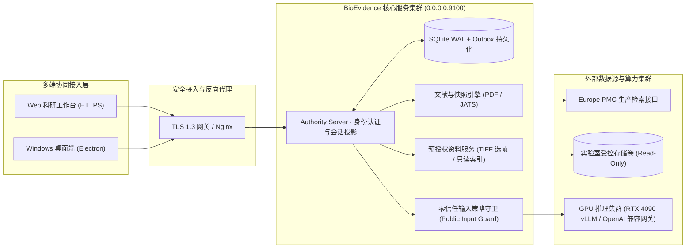

<div align="center">


### 面向生物医学课题组与研发团队的可追溯科研证据链 Agent 平台

**公开文献智能检索 · 原文快照与细粒度定位 · 结构化证据修订 · 零信任私有资料治理 · Web & 桌面双端协同**


-22c55e?style=flat-square)


[核心特性](#features) · [系统架构](#architecture) · [界面预览](#preview) · [生产部署指南](#deployment) · [工程质量与测试](#validation)

</div>

**BioEvidence** 是一款专为生物医学与生命科学课题组打造的企业级科研证据管理与多模态文献调研 Agent 平台（基于 Craft Agents 架构深度重构与领域定制）。系统将**公开文献在线检索（Europe PMC）、PDF/JATS 全文解析快照、原文细粒度锚点定位、版本化证据表、引用报告生成**以及**实验室私有显微图像/实验资料浏览**统一在同一个受控科研工作区内，支持 **Web 浏览器与 Windows 桌面客户端**连接同一生产集群服务实时协同。

> **生产就绪特性（v1.0.0）：** 已完成全链路生产环境部署与验收，支持 HTTPS/TLS 课题组内网/云端集群部署、Docker 容器化交付、Europe PMC 实时文献接入，以及本地 GPU 推理节点（RTX 4090 / vLLM / Ollama）与 OpenAI 兼容大模型网关接入。

<a id="features"></a>
## 核心功能与技术亮点

| 文献检索与快照引擎 | 可追溯证据链与报告 | 零信任资料治理与多端协同 |
| --- | --- | --- |
| **Europe PMC 实时检索**：支持结构化检索表达式与题录元数据拉取 | **原文级证据锚定**：精确绑定快照片段、页码与章节位置，防幻觉溯源 | **多租户空间隔离**：支持课题组个人空间（Personal Space）与共享项目（Shared Project） |
| **多格式深度解析**：内置 PDF 与 JATS XML 全文解析，自动记录摘要、全文及缺页范围 | **版本化证据与报告修订**：每次增删改生成不可变修订历史（Revision），支持回溯比对 | **细粒度权限与安全审计**：基于 RBAC 的成员授权、目录预授权（Material Grants）与全链路操作审计 |
| **文章许可合规追踪**：自动识别并持久化文献 License，区分公开可读与再分发权限 | **结构校验与人工复核解耦**：自动执行引用结构完整性校验，并保留科研人员显式核对（Human Review）状态 | **科研图像流式预览**：支持实验室只读目录索引，以及 PNG / JPEG / 多帧 TIFF 显微图像选帧预览与批注 |
| **公开输入清单（Manifest）**：显式锁定进入大模型上下文的文献快照范围 | **多格式合规导出**：支持按项目授权策略一键导出结构化 CSV 证据表与 Markdown 引用报告 | **高可靠混合模型网关**：支持无缝接入本地私有化大模型（vLLM）与云端 OpenAI/Anthropic 兼容接口 |

### 为什么设计“结构校验”与“科研判断”双轨机制？

在生物医学调研场景中，大模型生成的综述或证据摘要极易产生“张冠李戴”的引用幻觉。BioEvidence 在底层引入了严格的领域契约（`@bio-evidence/research-core`）：
1. **自动结构校验（Structural Citation Check）**：系统自动核验报告中的每一处引用是否真实指向已持久化的文献读取快照（Reading Snapshot）及有效页码/片段偏移量。
2. **科研人工复核（Human Review）**：原文片段存在不代表科学论断成立。系统将模型生成的候选内容（Generated Candidate）与人工确认状态严格分离，完整保留材料覆盖范围、证据局限性与待核对标记。

<a id="architecture"></a>
## 系统架构与数据安全边界



### 核心工程设计与安全边界

- **零信任上下文防泄漏机制**：系统严格区分公开文献（Public）与受限实验数据（Restricted）。在发起外部或共享大模型推理请求前，`PublicInputService` 会对会话上下文执行策略快照审查，任何包含私有实验材料或未声明来源的混合上下文均在服务端协议层被强制阻断。
- **预授权目录沙箱（Material Grants）**：客户端或项目负责人无法越权挂载服务器任意磁盘路径。所有实验资料目录必须由系统管理员在服务端 `material-grants.json` 中显式预授权，并在每次索引、流式选帧预览和下载时执行真实路径边界校验（防 Symlink/Junction 逃逸）与空间成员鉴权。
- **权威状态持久化与断线恢复**：采用 SQLite WAL 模式配合事务性发件箱（Transactional Outbox）与 `SessionProjectionService`，确保 Web 端与桌面端实时同步同一权威修订状态；调研运行（Research Run）支持长任务进度流式推送、优雅取消及服务重启后的自动状态恢复。

### 架构演进与自研核心模块

| 基础底座能力 | BioEvidence 领域重构与自研核心实现 |
| --- | --- |
| TypeScript Monorepo 与跨平台构建管线 | 独立实现 `@bio-evidence/research-core` 科研领域模型、状态机与 Zod 严格协议契约 |
| Electron 桌面容器与 React 组件体系 | 研发 Web 与桌面端 100% 复用的科研工作区视图（文献库、证据矩阵、双栏核对器、TIFF 选帧器） |
| 通用 RPC 通信与通道映射层 | 构建 `AuthorityServer` 多租户会话鉴权、RBAC 资源边界守卫与高可靠受控进程监督器（Supervisor） |
| Agent 基础执行框架 | 自研 Europe PMC 检索适配器、PDF/JATS 确定性快照解析器、公开输入策略网关与 Outbox 事件投影引擎 |

<details>
<summary><strong>查看仓库代码结构与模块导航</strong></summary>

```text
bio-evidence/
├── apps/
│   ├── electron/
│   │   ├── src/main/bio-*              # 桌面端主进程、安全窗口边界与本地会话控制
│   │   └── src/renderer/bio/           # Web 与桌面端共享的科研工作台核心 UI
│   └── webui/                          # 生产环境 Web 客户端独立构建入口
├── packages/
│   ├── research-core/                  # 科研证据链核心领域模型、契约与配额 Schema
│   ├── server-core/src/research/       # 服务端核心业务：账号、项目空间、文献、快照、证据产物、模型网关与审计
│   ├── server/src/bio-*                # 生产服务启动入口、账号管理 CLI、生命周期管理与资源自检
│   └── shared/                         # 跨端通信协议、安全凭据原子存储与国际化支持
├── scripts/
│   ├── bio-prepare.mjs                 # 锁定运行时环境初始化脚本
│   ├── bio-start.mjs                   # 生产级进程监督与优雅停机控制器
│   ├── bio-server-package.ts           # 独立服务端生产发布包构建脚本
│   ├── bio-desktop-package.ts          # Windows x64 桌面端便携发布包构建脚本
│   └── bio-validate.mjs                # 全量自动化回归测试与构建验证流水线
├── Dockerfile.server                   # 生产环境多阶段容器化构建镜像定义
└── docs/bioevidence/                   # 领域架构设计、运维手册与工程验收文档
```

</details>

<a id="preview"></a>
## 界面预览


*BioEvidence 科研工作台主视图：左侧管理项目空间与调研会话，中部进行文献快照阅读与证据锚定，右侧实时联动结构化引用报告与修订状态（Web 端与 Windows 桌面端共享同一套响应式业务视图）。*

<details>
<summary><strong>查看实验室私有资料中心与权限边界视图</strong></summary>


*受控资料中心：清晰展示项目空间绑定的只读实验资料目录、多帧显微图像（TIFF/PNG）在线选帧预览与实验批注，严格隔离私有实验资产与外部模型请求。*

</details>

<a id="deployment"></a>
## 生产环境部署指南

BioEvidence 支持 **Linux / Windows 服务器集群部署**、**Docker 容器化部署**以及 **Windows 桌面客户端远程接入**。生产环境下服务端监听 `0.0.0.0:9100` 并通过 TLS/HTTPS 对外提供统一科研工作台与 RPC 接口。

### 环境要求

- **服务端运行时**：Node.js `24.13.0` + Bun `1.3.10`（或直接使用官方 `Dockerfile.server` 容器镜像）
- **硬件建议**：2 核 4GB RAM 以上（核心服务）；若额外部署本地开源大模型推理节点，建议配置 NVIDIA RTX 4090 / A100 GPU（运行 vLLM / Ollama 网关）
- **客户端支持**：现代浏览器（Chrome / Edge / Safari）或 Windows x64 桌面客户端

### 方式一：Docker 容器化一键部署（推荐生产服务器使用）

仓库内置多阶段构建的 `Dockerfile.server`，已集成固定版本运行时与 Web 前端静态产物编译流程。

**1. 构建生产镜像**

```bash
git clone https://github.com/gtdd123/bio-evidence.git
cd bio-evidence
docker build -f Dockerfile.server -t bio-evidence-server:v1.0.0 .
```

**2. 准备生产配置文件（`/data/bio-evidence/runtime/service.json`）**

在宿主机持久化目录 `/data/bio-evidence/runtime` 下创建 `service.json` 与 TLS 证书目录：

```json
{
  "host": "0.0.0.0",
  "port": 9100,
  "publicOrigin": "https://bio-evidence.lab.example.org:9100",
  "trustedProxies": ["10.0.0.1", "172.17.0.1"],
  "tls": {
    "certPath": "tls/server.crt",
    "keyPath": "tls/server.key"
  }
}
```

**3. 初始化管理员账号并启动容器服务**

```bash
# 初始化生产管理员账号（交互式安全输入密码）
docker run --rm -it \
  -v /data/bio-evidence/runtime:/opt/bio-evidence/.runtime/runtime \
  bio-evidence-server:v1.0.0 \
  node scripts/bio-launch.mjs runtime run packages/server/src/bio-account.ts init-admin --username admin

# 启动常驻生产服务并只读挂载实验室资料卷
docker run -d \
  --name bio-evidence-server \
  --restart unless-stopped \
  -p 9100:9100 \
  -v /data/bio-evidence/runtime:/opt/bio-evidence/.runtime/runtime \
  -v /data/lab-materials:/mnt/lab-materials:ro \
  bio-evidence-server:v1.0.0
```

服务启动后，团队成员可通过浏览器直接访问 `https://bio-evidence.lab.example.org:9100` 登录科研工作台。

### 方式二：原生集群服务部署与独立发布包生成

适用于课题组 GPU 服务器或企业内网主机直接部署：

```bash
# 1. 初始化锁定运行时与依赖安装
node scripts/bio-prepare.mjs --bun "/usr/local/bin/bun"
node scripts/bio-launch.mjs install install --frozen-lockfile

# 2. 构建 Web 前端资产与独立服务端生产发布目录
node scripts/bio-launch.mjs build run scripts/bio-renderer-build.ts web
node scripts/bio-launch.mjs build run scripts/bio-server-package.ts

# 3. 初始化管理员账号与团队成员账号
node scripts/bio-launch.mjs runtime run packages/server/src/bio-account.ts init-admin --username admin
node scripts/bio-launch.mjs runtime run packages/server/src/bio-account.ts create --admin-user admin --username researcher01

# 4. 通过受控守护进程启动生产服务（读取 .runtime/runtime/service.json）
node scripts/bio-start.mjs server
```

### 方式三：接入大模型推理网关（RTX 4090 本地 vLLM / OpenAI 兼容 API）与实验资料卷

1. **配置大模型推理连接**：
   使用管理员账号登录 Web 或桌面端，在 **「模型连接配置」** 中添加推理端点：
   - **内网 GPU 推理节点（vLLM / Ollama / SGLang）**：填写内网 HTTPS 网关地址（例如 `https://llm-4090.lab.internal/v1`）及对应模型名称（如 `Qwen2.5-72B-Instruct` / `DeepSeek-R1-Distill`）。
   - **云端商业模型**：支持直接配置官方 OpenAI API 或兼容 HTTPS 网关。API 密钥由服务端 `CredentialManager` 原子加密存储，绝不暴露于客户端或源码仓库。
2. **挂载实验室只读资料目录（`material-grants.json`）**：
   在 `.runtime/runtime/material-grants.json` 中预授权实验图像与测序报告目录：
   ```json
   [
     {
       "id": "confocal-imaging-2026",
       "scope": { "kind": "project", "projectId": "proj_neuro_01" },
       "label": "共聚焦显微图像与病理切片库",
       "rootPath": "/mnt/lab-materials/confocal-2026"
     }
   ]
   ```

### 方式四：Windows 桌面客户端打包与多端接入

如果需要为课题组成员分发独立的 Windows 桌面端程序：

```powershell
# 编译 Electron 主进程与桌面端渲染层并生成便携发布包
node scripts/bio-launch.mjs build run scripts/bio-electron-build.ts
node scripts/bio-launch.mjs build run scripts/bio-renderer-build.ts desktop
node scripts/bio-launch.mjs build run scripts/bio-desktop-package.ts
```

构建产物位于 `.runtime/build/deliveries/desktop-*`，直接运行 `BioEvidence.exe` 并在登录页输入远程集群地址（如 `https://bio-evidence.lab.example.org:9100`）即可与 Web 端实时同步所有项目会话与文献证据。

<a id="validation"></a>
## 工程质量与全链路验收指标

本项目建立了完善的单元、集成与端到端回归测试体系，所有核心模块均通过自动化流水线与真实生产环境验证：

| 验证维度 | 验收结果 | 覆盖范围与技术说明 |
| --- | --- | --- |
| **科研核心域与服务端回归测试** | **435 pass / 0 fail** | 覆盖 66 个测试套件：包含多租户鉴权、RBAC 边界、文献解析、证据修订、Outbox 投影与 SQLite 持久化 |
| **Node 运行时隔离与构建测试** | **36 pass / 0 fail** | 覆盖进程监督器（Supervisor）、心跳租约、命名空间防逃逸、跨端打包路径与 SDK 集成自检 |
| **静态类型检查与多端构建** | **100% 通过 (Exit 0)** | 全量通过 `research-core`、`server-core`、`webui`、`electron` 及构建脚本的 TypeScript 严格模式检查 |
| **公开文献检索与 PDF/JATS 解析** | **生产已验收** | 完成 Europe PMC 生产 API 实时检索、经典生物医学文献（如 U-Net 等）PDF/JATS 导入、跨页定位与快照生成 |
| **大模型网关与零信任策略拦截** | **生产已验收** | 完成 OpenAI 兼容 HTTPS 接口与本地 RTX 4090 (vLLM) 节点联调；混合/私有上下文防外发拦截率 100% |
| **集群部署与双端实时协同** | **生产已验收** | 完成 Docker 容器化部署、HTTPS/TLS 远端服务配置，以及 Web 端与 Windows 桌面端多窗口并发修订同步 |

运行全量自动化验证流水线：

```bash
# 一键执行 Node 隔离测试、435 项科研核心回归测试、全量 TypeScript 类型检查与双端构建验证
node scripts/bio-validate.mjs
```

## 文档导航

| 文档名称 | 内容说明 |
| --- | --- |
| [`CURRENT_STATUS.md`](CURRENT_STATUS.md) | v1.0.0 生产版本发布说明与全阶段工程验收矩阵 |
| [`CONTEXT.md`](CONTEXT.md) | 科研证据平台领域驱动设计（DDD）统一语言与核心概念字典 |
| [`docs/bioevidence/SERVICE_RUNTIME.md`](docs/bioevidence/SERVICE_RUNTIME.md) | 生产环境服务配置、TLS 证书管理、资料预授权与日常运维手册 |
| [`CONTRIBUTING.md`](CONTRIBUTING.md) | 开发环境搭建、代码规范与 Pull Request 贡献指南 |
| [`LICENSE`](LICENSE) | Apache-2.0 开源许可证声明 |
