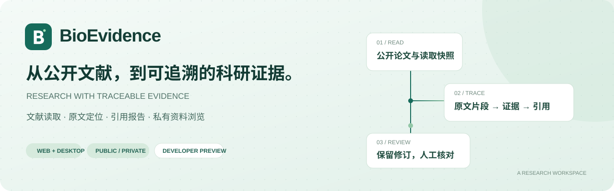
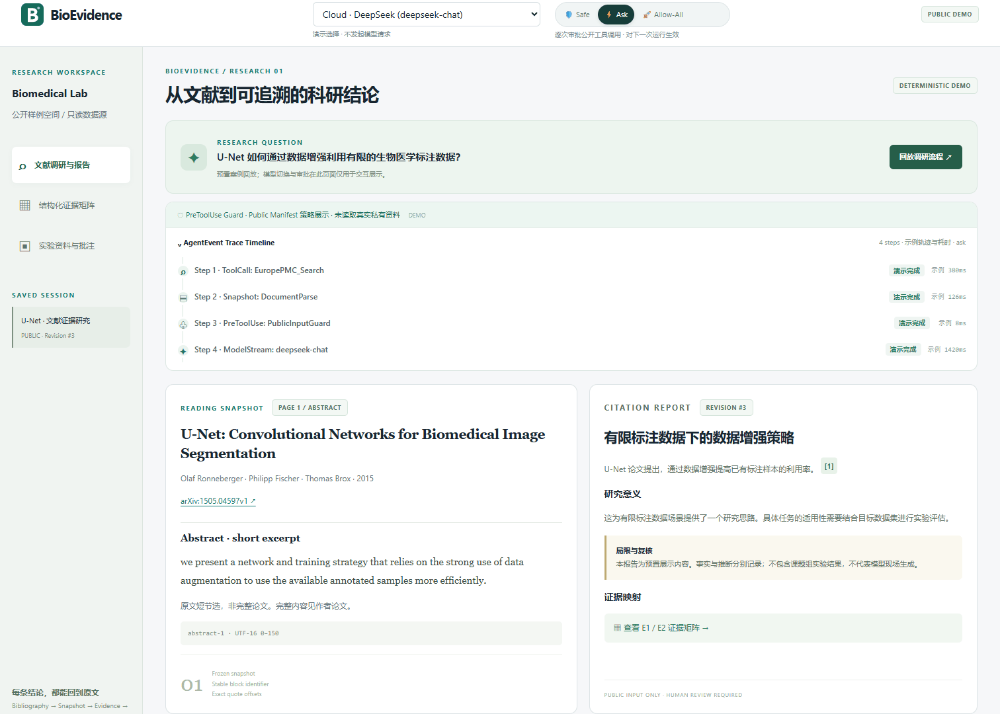
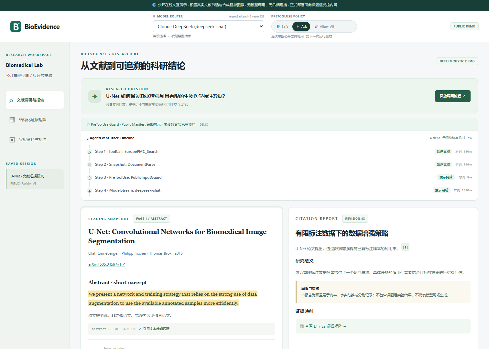
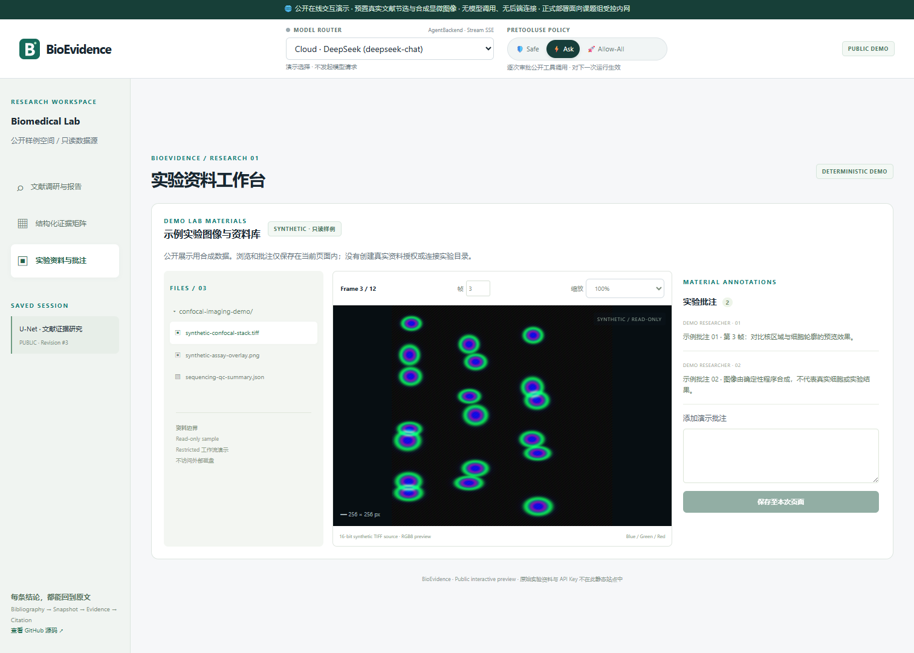
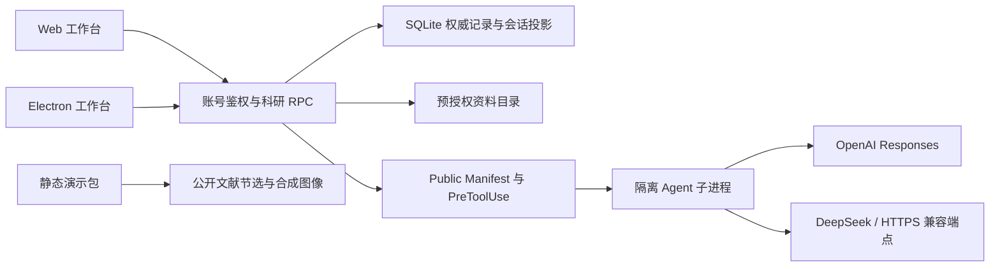

<div align="center">


### 让每一条科研结论，都能回到原文

公开文献调研 · 可追溯证据矩阵 · 版本化引用报告 · 受控实验资料


[交互演示](#交互演示) · [核心能力](#核心能力) · [快速开始](#快速开始) · [部署与配置](docs/bioevidence/SERVICE_RUNTIME.md) · [当前能力](CURRENT_STATUS.md)
</div>

BioEvidence 面向课题组的文献整理与科研协作：将公开文献片段组织为带原文锚点的证据，再形成可复核的引用报告。Web 和 Electron 共用科研界面，服务端统一管理账号、项目权限、修订记录与运行任务。

## 交互演示



*录屏展示预置调研流程、Ask 审批交互、引用定位与合成显微图像预览。演示没有调用真实模型，也没有连接课题组实验数据库。*



<details>
<summary>查看合成显微资料、选帧与批注</summary>



示例包含 12 帧确定性合成的 16-bit TIFF 及 RGB8 浏览器预览。图像不代表真实细胞或实验结果。
</details>

### 不配置后端也能体验

```bash
node scripts/bio-demo-build.mjs
node scripts/bio-demo-serve.mjs
```

打开 `http://127.0.0.1:5176`。构建结果在 `apps/webui/dist-demo/`，可以部署到静态网站托管服务，也支持子路径发布。演示站不需要 SQLite、账号或 API Key。

直接使用 Vite 时，通过 `VITE_DEMO_MODE=true` 选择同一演示构建。这个开关只控制前端构建，不能切换或绕过正式服务端的鉴权。

## 核心能力

| 工作流 | 使用方式 |
| --- | --- |
| 文献与快照 | Europe PMC 题录检索、公开 PDF 导入、PDF/JATS 文本快照；区分全文、摘要和缺页范围 |
| 证据与引用 | 论断绑定 snapshot / block / UTF-16 偏移；证据和报告按修订保存，人工复核状态独立记录 |
| 模型路由 | 官方 OpenAI Responses、DeepSeek 与 OpenAI-compatible Chat Completions；课题组 HTTPS 推理端点使用 Lab 分组 |
| 执行轨迹 | 展示实际保存的公开输入校验、模型请求回执、工具请求/决定/完成及产物校验；已有快照不会被显示为新执行的检索或解析 |
| 多人协作 | 个人空间与共享项目，按当前账号和项目权限授权；Web / Electron 观察同一服务端任务 |
| 受控资料 | 运维预授权只读目录、分页文件索引、多帧图像预览与私有批注；无目录时可独立浏览内置合成样例 |

### 三种执行模式

- **Safe**：只使用已选择的公开输入，不向 Agent 暴露工具。
- **Ask**：默认模式，每次白名单公开工具调用均等待运行发起者批准，45 秒后失效。
- **Allow-All**：自动批准白名单内的公开只读工具。当前工具为 `get_public_block` 和 `get_public_evidence`。

三种模式都执行公开输入清单、权限和运行租约检查。私有资料不会因切换模式而获得模型外发许可。顶部选择作用于下一次运行，已接受任务的模型与模式保持固定。

模型路由的绿色状态表示该连接修订与模型在最近五分钟内有成功请求回执，并显示时间；保存配置本身不会点亮绿灯。静态演示单独标注演示状态。

## 结构



模型密钥保存在服务端凭据库，前端只接收授权范围内的模型元数据。静态演示与正式后端分别构建，不加载正式登录或 WebSocket 客户端。

## 快速开始

需要 Node.js 24 与 Bun 1.3.10。先在项目目录执行：

```bash
node scripts/bio-prepare.mjs --bun "/path/to/bun"
node scripts/bio-launch.mjs install install --frozen-lockfile
node scripts/bio-launch.mjs build run scripts/bio-renderer-build.ts web
```

首次创建管理员，设置至少 12 位登录密码，然后启动服务：

```bash
node scripts/bio-launch.mjs runtime run packages/server/src/bio-account.ts init-admin --username admin
node scripts/bio-start.mjs server
```

打开 `http://127.0.0.1:9100/login`。管理员登录后，通过「模型连接配置」添加供应商、模型 ID、密钥和授权空间。

### 默认模型连接

也可以在服务端进程环境中提供 `OPENAI_API_KEY`、`DEEPSEEK_API_KEY`，服务启动时为已有活跃管理员的个人空间创建默认连接。已有配置始终保留，不覆盖已有密钥或禁用状态。

`.env.example` 是变量清单。运行器不自动读取仓库中的 `.env`；请通过操作系统、服务管理器或容器 Secret 注入。构建和测试不继承模型密钥。模型 ID 可通过 `OPENAI_MODELS`、`DEEPSEEK_MODELS` 配置，多个 ID 用逗号分隔；具体可用性由供应商账户决定。

课题组推理端点使用 `LAB_API_BASE_URL`、`LAB_API_KEY`、`LAB_MODEL`，要求 HTTPS，并遵循相同公开输入限制。服务器上的 GPU 不影响平台后端本身的运行。

## 开发与验证

```bash
node scripts/bio-validate.mjs
```

该入口运行单元、集成与契约测试、类型检查、Web / Electron 构建及资源自检。当前执行结果见 [CURRENT_STATUS.md](CURRENT_STATUS.md)。

```text
apps/electron/src/renderer/bio/     共享科研界面与内置示例
apps/webui/src/demo/               独立静态交互演示
packages/research-core/            科研契约与运行数据结构
packages/server-core/src/research/ 鉴权、文献、资料、模型与执行服务
packages/server/src/bio-*          服务、账号与资源自检入口
scripts/bio-*                     隔离启动、构建、验收与静态预览
```

## 许可证与素材

代码按 [Apache-2.0](LICENSE) 发布，必要的上游版权与第三方归属见 [NOTICE](NOTICE)。演示文献元数据及短节选来自 [U-Net 原始论文](https://arxiv.org/abs/1505.04597v1)，作者为 Olaf Ronneberger、Philipp Fischer、Thomas Brox。合成显微素材由 `scripts/bio-demo-assets.mjs` 确定性生成，随本项目代码许可分发；不包含课题组实验数据。
