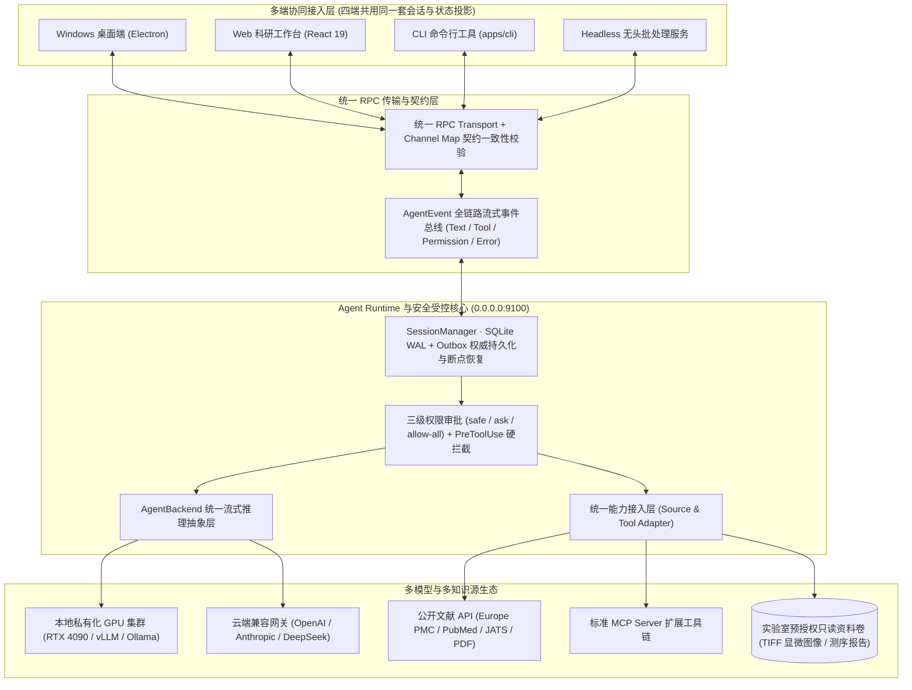

<div align="center">


### 面向医药研发与医学团队的私有化多端 Agent 协同与可追溯证据平台

**多端同源协同 (Desktop / Web / CLI / Headless) · 本地与云端模型无缝切换 · MCP/API/本地知识源统一接入 · PreToolUse 安全审批 · 双环评测迭代**


-22c55e?style=flat-square)


[核心架构与设计](#architecture) · [功能特性](#features) · [可观测与安全边界](#security) · [评测与双环迭代](#evaluation) · [界面预览](#preview) · [生产部署指南](#deployment)

</div>

**BioEvidence** 是面向生物医药研发与医学临床研究团队自研的**可私有化部署多端 Agent 协同平台**。针对医学研发场景中“AI 工具碎片化、实验与临床数据高度敏感、多人协作易串线、长文献综述引用易幻觉”的核心痛点，平台在底层构建了统一的 **Agent Runtime、多端 RPC 会话核心、统一能力接入层（MCP / API / 本地受控资料）与 `PreToolUse` 安全拦截器**，实现 **Windows 桌面端（Electron）、Web 端、CLI 与无头服务（Headless Server）** 四端共用同一套会话状态与模型连接核心——**同一份 Agent 逻辑多端复用、换端续跑不重来、多人协作不串线、全过程可审计可回溯**。

<a id="architecture"></a>
## 核心架构与工程设计



### 1. 运行时与多端同源复用（Runtime & Multi-Client Reuse）

- **本地与云端模型无缝切换（`AgentBackend` 统一抽象）**：针对医学实验数据敏感、课题组需在“内网本地 GPU 推理”与“云端大模型”间灵活切换的需求，平台抽象了 `AgentBackend` 统一流式事件接口，将不同模型厂商 SDK 与本地推理框架（vLLM / Ollama / OpenAI / Claude）的协议差异彻底收敛在适配层，**切换本地或云端模型仅需修改连接配置，上层业务与工具链零改动**。
- **桌面、Web、CLI 与无头服务续接同一份会话**：科研人员常在实验室桌面端发起文献检索与实验比对，随后在网页端或通过 CLI 继续同一段调研。平台通过**统一 RPC 传输层 + `Channel Map` 契约一致性测试**，配合服务端 SQLite WAL + Transactional Outbox 投影机制，让四端实时共享同一权威会话状态，**跨端无缝接续，协议漂移在编译与契约测试阶段即被拦截**。
- **文献库、MCP 与内部资料统一接入**：将外部公开文献源（Europe PMC / PDF / JATS XML）、标准 **MCP（Model Context Protocol）服务**以及实验室内部只读资料库统一封装为标准 Agent Tool 适配接口，凭据由服务端 `CredentialManager` 原子加密托管，**接入新知识源仅需新增一个 Source Adapter**。

<a id="features"></a>
### 2. 生物医药证据链与多模态科研工作区

| 文献检索与确定性快照 | 可追溯证据链与防幻觉校验 | 实验室受控资料与多端协同 |
| --- | --- | --- |
| **Europe PMC / PDF / JATS 深度解析**：实时拉取题录与全文，自动区分摘要、全文及缺页层级并生成不可变读取快照（Reading Snapshot） | **原文级锚定与版本化修订**：每条科研论断（Evidence Item）精确绑定原文快照片段、页码与偏移量，每次修改生成可回溯 Revision | **多租户空间与 RBAC 隔离**：支持个人空间（Personal Space）与课题组共享项目（Shared Project），管理员不默认越权访问私有空间 |
| **多模态科研图像选帧预览**：支持实验室只读目录挂载，原生支持高分辨率 **PNG / JPEG / 多帧 TIFF 显微图像** 在线选帧预览与实验批注 | **结构校验与人工复核双轨解耦**：自动执行引用结构完整性校验（Structural Citation Check），并与科研人员显式核对（Human Review）状态解耦 | **多格式合规导出**：在权限审批通过后，支持一键导出带完整溯源锚点的 CSV 证据矩阵与 Markdown 结构化综述报告 |

<a id="security"></a>
## 可观测性与零信任安全边界

### 1. `AgentEvent` 全链路流式可观测与断点重跑

针对长周期文献调研与多步工具调用容易陷入“黑盒等待、报错难定位”的问题，平台定义了标准化的 **`AgentEvent` 流式事件协议**：
- 实时向多端推送 **思维链文本增量（Text Delta）、工具调用入参/出参（Tool Call & Result）、权限审批挂起状态（Permission Prompt）与结构化异常码（ResearchError）**。
- 所有事件流通过 JSONL 与 SQLite Outbox 持久化落盘，支持长任务随时中断、进程重启后自动恢复执行上下文（`recoverResearchRuns`），实现**执行过程全透明、历史轨迹可回溯、失败节点可定点重跑**。

### 2. 三级操作审批（`safe` / `ask` / `allow-all`）与 `PreToolUse` 硬拦截

科研报告生成、外部模型请求与内部实验资料外发属于高风险不可逆操作，仅靠系统提示词（Prompt）约束极易被绕过。平台在执行引擎底层实现了**代码级安全闸门**：
- **三级权限策略**：支持按会话与项目空间配置 `safe`（只读沙箱模式，严禁任何写操作与外发）、`ask`（敏感工具与外发操作挂起并弹窗等待人工审批）、`allow-all`（受控批处理自动化模式）。
- **`PreToolUse` 与 `PublicInputGuard` 硬拦截**：在任何工具执行或跨网模型调用触发前，拦截器强制校验当前会话的数据分类策略（Public vs. Restricted）与真实磁盘路径边界（防 Symlink/Junction 逃逸），**先审批、再放行、全链路审计留痕且支持版本回滚**。

<a id="evaluation"></a>
## 评测体系与双环迭代（Evaluation & Flywheel）

为防止模型切换、Prompt 调优或 Tool/Skill 升级引入隐性退化，项目构建了覆盖“端到端结果”与“过程轨迹”的闭环评测体系：

1. **端到端与过程轨迹双环评测**：围绕**文献精准检索、多篇证据对比、无幻觉引用报告生成**三大核心场景，结合 `AgentEvent` 工具调用轨迹与真实课题组试用反馈，自动捕获并归因 Bad Case（如检索表达式召回不足、跨页快照偏移、未授权上下文误引）。
2. **黄金集（Golden Set）与错题集（Hard Case Set）沉淀**：将试用反馈中的高价值成功链路与典型失败案例持续回流，固化为确定性测试夹具（`.fixtures` 与离线快照测试集），在固定输入资料与初始状态下执行多轮回归回测。
3. **三维分级评分校准**：从 **任务完成度（Task Completion）**、**核心事实覆盖率（Fact Coverage）** 与 **原文引用支撑度（Citation Faithfulness）** 三个维度建立量化分级评分标准，驱动 Prompt 与检索重排策略持续迭代。

<details>
<summary><strong>查看仓库 Monorepo 模块架构与目录导航</strong></summary>

```text
bio-evidence/
├── apps/
│   ├── cli/                            # CLI 命令行终端客户端与服务进程派生器
│   ├── electron/
│   │   ├── src/main/bio-*              # 桌面端主进程、安全窗口边界与本地会话控制
│   │   └── src/renderer/bio/           # 桌面端与 Web 端 100% 复用的科研工作台 UI
│   ├── viewer/                         # 独立只读文献与证据报告检视器
│   └── webui/                          # 生产环境 Web 客户端独立构建入口
├── packages/
│   ├── core/                           # 基础核心类型与通用工具库
│   ├── pi-agent-server/                # Agent 运行时服务化封装与流式事件分发
│   ├── research-core/                  # 医药科研证据链领域契约、状态机与 Zod 严格 Schema
│   ├── server-core/src/research/       # 核心服务端：多租户鉴权、文献解析、快照、证据修订、模型网关与安全审计
│   ├── server/src/bio-*                # 生产服务入口、账号管理 CLI、生命周期监督与资源自检
│   ├── session-mcp-server/             # 会话级 MCP 协议服务与工具注册中心
│   ├── session-tools-core/             # 安全工具执行器与 PreToolUse 拦截核心
│   ├── shared/                         # 统一 RPC 协议、Channel Map 契约、AgentBackend 抽象与原子凭据存储
│   └── ui/                             # 跨端共享原子 UI 组件库
├── scripts/                            # 运行时锁定、跨端打包、进程守护与全量回归验证流水线
└── Dockerfile.server                   # 生产环境多阶段容器化部署镜像定义
```

</details>

<a id="preview"></a>
## 界面预览


*BioEvidence 多端科研工作台：左侧管理多租户项目空间与调研会话，中部执行文献快照精读与原文级证据锚定，右侧实时联动版本化引用报告与人工复核状态（Windows 桌面端与 Web 端共享同一套业务视图与会话投影）。*

<details>
<summary><strong>查看实验室受控资料中心与权限沙箱视图</strong></summary>


*零信任受控资料中心：目录须由管理员通过 `material-grants.json` 显式预授权并与项目空间绑定，支持只读目录索引与多帧显微图像（TIFF/PNG）在线选帧预览，严防私有实验数据越权访问或外发泄露。*

</details>

<a id="deployment"></a>
## 生产环境部署指南

BioEvidence 支持 **Docker 容器化一键部署**、**Linux / Windows 原生集群部署**，以及 **桌面端 / Web / CLI 多端远程接入**。生产环境下服务端监听 `0.0.0.0:9100` 并通过 TLS/HTTPS 对外提供统一科研工作台与 RPC 接口。

### 环境要求

- **服务端运行时**：Node.js `24.13.0` + Bun `1.3.10`（或直接使用内置多阶段构建的 `Dockerfile.server`）
- **推荐算力配置**：核心服务仅需 2 核 4GB RAM；若部署课题组本地大模型推理节点，推荐配置 NVIDIA RTX 4090 / A100 GPU（运行 vLLM / Ollama / SGLang 网关）
- **客户端支持**：Windows x64 桌面端（`BioEvidence.exe`）、现代浏览器（Chrome / Edge / Safari）及跨平台 CLI

### 方式一：Docker 容器化一键部署（推荐生产服务器使用）

**1. 构建生产镜像**

```bash
git clone https://github.com/gtdd123/bio-evidence.git
cd bio-evidence
docker build -f Dockerfile.server -t bio-evidence-server:v1.0.0 .
```

**2. 配置生产网络与 TLS 证书（`/data/bio-evidence/runtime/service.json`）**

```json
{
  "host": "0.0.0.0",
  "port": 9100,
  "publicOrigin": "https://bio-evidence.lab.example.org:9100",
  "trustedProxies": ["10.0.0.1", "172.17.0.1"],
  "tls": {
    "certPath": "tls/server.crt",
    "keyPath": "tls/server.key"
  }
}
```

**3. 初始化管理员并启动常驻容器服务**

```bash
# 交互式安全初始化管理员账号（密码经高强度哈希持久化，无默认密码）
docker run --rm -it \
  -v /data/bio-evidence/runtime:/opt/bio-evidence/.runtime/runtime \
  bio-evidence-server:v1.0.0 \
  node scripts/bio-launch.mjs runtime run packages/server/src/bio-account.ts init-admin --username admin

# 启动生产服务并只读挂载实验室资料卷
docker run -d \
  --name bio-evidence-server \
  --restart unless-stopped \
  -p 9100:9100 \
  -v /data/bio-evidence/runtime:/opt/bio-evidence/.runtime/runtime \
  -v /data/lab-materials:/mnt/lab-materials:ro \
  bio-evidence-server:v1.0.0
```

### 方式二：原生集群服务部署与多端构建

```bash
# 1. 初始化锁定运行时并安装依赖
node scripts/bio-prepare.mjs --bun "/usr/local/bin/bun"
node scripts/bio-launch.mjs install install --frozen-lockfile

# 2. 构建 Web 前端资产与独立服务端生产发布包
node scripts/bio-launch.mjs build run scripts/bio-renderer-build.ts web
node scripts/bio-launch.mjs build run scripts/bio-server-package.ts

# 3. 初始化管理员与课题组成员账号并启动受控守护进程
node scripts/bio-launch.mjs runtime run packages/server/src/bio-account.ts init-admin --username admin
node scripts/bio-launch.mjs runtime run packages/server/src/bio-account.ts create --admin-user admin --username researcher01
node scripts/bio-start.mjs server
```

### 方式三：本地 GPU 模型切换与预授权资料挂载

1. **一键切换本地 / 云端模型后端**：
   管理员登录工作台后，在 **「模型连接配置」** 中可随时添加或切换推理后端：
   - **本地私有化 GPU 节点（RTX 4090 vLLM / Ollama）**：配置内网端点（如 `https://llm-4090.lab.internal/v1`）与本地医药领域模型或通用推理模型（如 `Qwen2.5-72B-Instruct` / `DeepSeek-R1`）。
   - **云端商业模型**：支持 OpenAI / Anthropic 兼容 HTTPS 接口，密钥由服务端 `CredentialManager` 原子加密存储。
2. **配置预授权只读资料卷（`.runtime/runtime/material-grants.json`）**：
   ```json
   [
     {
       "id": "confocal-imaging-2026",
       "scope": { "kind": "project", "projectId": "proj_neuro_01" },
       "label": "共聚焦显微图像与病理切片库",
       "rootPath": "/mnt/lab-materials/confocal-2026"
     }
   ]
   ```

### 方式四：Windows 桌面端打包分发

```powershell
node scripts/bio-launch.mjs build run scripts/bio-electron-build.ts
node scripts/bio-launch.mjs build run scripts/bio-renderer-build.ts desktop
node scripts/bio-launch.mjs build run scripts/bio-desktop-package.ts
```

构建产物位于 `.runtime/build/deliveries/desktop-*`，运行 `BioEvidence.exe` 并填入集群服务地址（如 `https://bio-evidence.lab.example.org:9100`），即可与 Web 端及 CLI 实时共享同一科研会话。

<a id="validation"></a>
## 工程质量与契约测试矩阵

项目建立了覆盖 **RPC 通道契约、多租户安全边界、文献解析快照、AgentEvent 事件投影与黄金集回归** 的完整自动化验证流水线：

| 验证维度 | 验收结果 | 覆盖范围与技术说明 |
| --- | --- | --- |
| **科研核心域与多端契约回归测试** | **435 pass / 0 fail** | 覆盖 66 个核心测试套件：包含 `Channel Map` 契约一致性、RBAC 鉴权、文献解析、证据修订与 SQLite Outbox 投影 |
| **Node 运行时隔离与监督器测试** | **36 pass / 0 fail** | 覆盖进程监督器（Supervisor）、Turn 租约与心跳控制、命名空间防逃逸与跨端打包完整性 |
| **全量静态类型检查与多端构建** | **100% 通过 (Exit 0)** | 全量通过 `research-core`、`server-core`、`shared`、`webui`、`electron` 的 TypeScript 严格模式检查 |
| **公开文献检索与 PDF/JATS 解析** | **生产已验收** | 完成 Europe PMC 实时检索、经典生物医学文献（如 U-Net 等）PDF/JATS 全文快照、跨页定位与引用结构校验 |
| **混合模型切换与 PreToolUse 拦截** | **生产已验收** | 完成本地 RTX 4090 (vLLM) 与 OpenAI 兼容网关无缝切换；受限实验上下文外发与越权写操作 100% 硬拦截 |

一键运行全量自动化验证流水线：

```bash
node scripts/bio-validate.mjs
```

## 文档导航

| 文档名称 | 内容说明 |
| --- | --- |
| [`CURRENT_STATUS.md`](CURRENT_STATUS.md) | v1.0.0 生产版本架构交付与全链路工程验收矩阵 |
| [`CONTEXT.md`](CONTEXT.md) | 医药科研证据平台领域驱动设计（DDD）统一语言与核心概念字典 |
| [`docs/bioevidence/SERVICE_RUNTIME.md`](docs/bioevidence/SERVICE_RUNTIME.md) | 生产环境集群配置、TLS 证书管理、资料预授权与日常运维手册 |
| [`CONTRIBUTING.md`](CONTRIBUTING.md) | 开发环境搭建、代码规范与贡献指南 |
| [`LICENSE`](LICENSE) | Apache-2.0 开源许可证声明 |
