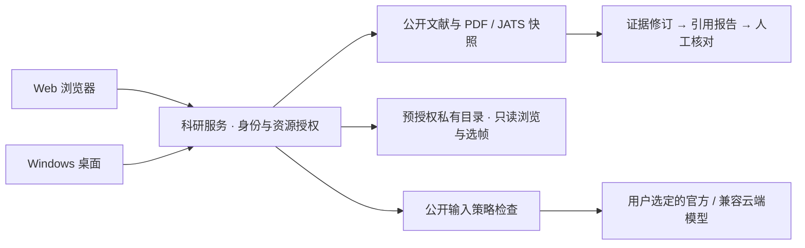

<div align="center">


**面向课题组的科研 Agent 工作区**

公开文献调研 · 可追溯证据 · 引用报告 · 私有资料浏览

[](#validation)
[](package.json)
[](#desktop)
[](LICENSE)

[项目能力](#features) · [界面预览](#preview) · [快速启动](#quick-start) · [架构与边界](#architecture) · [验证状态](#validation)

</div>

BioEvidence 基于 **Craft Agents 0.11.4** 二次开发，把论文、原文片段、证据和报告组织在同一科研会话中。Web 与 Windows 桌面连接同一个服务，共享账号、项目、修订和运行状态。

> **0.1.0 公开源码预览版。** 本机已验证公开 PDF → 证据 → 引用报告 → 双端核对；真实模型调用和生产环境 Europe PMC 在线检索尚未验收通过。当前可先使用不依赖模型的手工整理链路。详见[验收记录](docs/bioevidence/evidence/T17-acceptance.md)。

<a id="features"></a>
## 一个工作区，串起科研证据链

| 文献与来源 | 证据与报告 | 资料与协作 |
| --- | --- | --- |
| PDF / JATS 读取与快照 | 原文片段、页码与定位 | 个人空间与课题项目 |
| 摘要、全文及缺页分别记录 | 证据表与引用报告修订 | 项目角色、资源授权与审计 |
| 公开文献检索适配器 | 冲突保留、历史版本、人工核对 | 私有目录只读索引、搜索和批注 |
| 显式选择公开来源与输入 | CSV / Markdown 授权导出 | PNG / JPEG / 普通 TIFF 选帧预览 |

公开调研 Agent 支持配置官方 OpenAI 与 HTTPS 兼容接口，记录运行进度，提供取消、重试和重启恢复。模型未配置时，检索/导入、手工证据整理和资料浏览仍可独立使用；在线检索还取决于运行环境的公网访问条件。

**结构校验与科研判断分别记录。** 原文片段匹配，不代表论断已被科学证实；报告保留未核对状态、材料范围、局限和缺失信息。

<a id="preview"></a>
## 界面预览

<!-- Real UI captures only. No credentials, experiment data or third-party PDF pages. -->


*真实 Windows 桌面界面，使用合成账号与演示项目。桌面与 Web 复用同一业务界面。*

<details>
<summary><strong>查看私有资料入口与未接入提示</strong></summary>


空空间明确显示“尚未接入资料目录”。目录须由管理员预授权，再由有权限的空间所有者或项目负责人登记；平台不会自动连接实验服务器。

</details>

<a id="quick-start"></a>
## 快速启动

本机验证环境：**Windows x64 · Node 24.13.0 · Bun 1.3.10 · Electron 39.2.7**。其他系统与全新机器安装尚未验证。

### 1. 获取源码，准备固定运行时

先从 [Bun 官方发行页](https://github.com/oven-sh/bun/releases/tag/bun-v1.3.10) 获取并解压 Bun 1.3.10，然后执行：

```powershell
git clone https://github.com/gtdd123/bio-evidence.git
cd bio-evidence
node scripts/bio-prepare.mjs --bun "D:\tools\bun.exe"
node scripts/bio-launch.mjs install install --frozen-lockfile
```

将示例 Bun 路径替换为自己的路径。准备脚本只复制现有运行时，不修改全局 PATH。内部 `@craft-agent/*` 包名保留以兼容源码结构。

### 2. 启动服务与 Web

在私人交互终端中初始化管理员，按提示隐藏输入密码：

```powershell
node scripts/bio-launch.mjs build run scripts/bio-renderer-build.ts web
node scripts/bio-launch.mjs runtime run packages/server/src/bio-account.ts init-admin --username admin
node scripts/bio-start.mjs server
```

打开 [http://127.0.0.1:9100](http://127.0.0.1:9100)。没有默认账号或默认密码。登录后创建项目与会话，即可导入明确声明公开的 PDF、整理证据、创建引用报告。模型连接由管理员在界面配置；密钥仅在服务端使用，不写入 `.env` 或客户端。

按 **Ctrl+C** 通过本地监督通道关闭服务；超时强制终止会记为失败。账户、数据库、凭据和运行记录保存在 `.runtime/runtime/`，不要公开或随软件分发。

<a id="desktop"></a>
### 3. 启动 Windows 桌面

保持服务运行，另开终端：

```powershell
node scripts/bio-launch.mjs build run scripts/bio-electron-build.ts
node scripts/bio-launch.mjs build run scripts/bio-renderer-build.ts desktop
node scripts/bio-start.mjs desktop
```

桌面登录页填写同一服务地址。每个窗口独立登录；客户端不内置服务或模型密钥。源码客户端使用项目隔离目录，正式便携客户端使用 `%APPDATA%\BioEvidence`。

<details>
<summary><strong>新增团队账号与生成运行目录</strong></summary>

新增账号前先停止服务，再按提示输入管理员密码和新密码：

```powershell
node scripts/bio-launch.mjs runtime run packages/server/src/bio-account.ts create --admin-user admin --username student
```

重启后在项目成员界面授权。生成运行目录：

```powershell
# Windows x64 未签名便携目录：整个目录一起保留
node scripts/bio-launch.mjs build run scripts/bio-desktop-package.ts

# 独立 Bun 服务目录：包含 Web 资产与真实解析/图像/SDK 资源
node scripts/bio-launch.mjs build run scripts/bio-server-package.ts
```

输出位于新的 `.runtime/build/deliveries/desktop-*` 或 `service-*`。桌面入口为 `BioEvidence.exe`；尚无安装器、签名、自动更新或 OS 协议注册。服务目录仍需 Node 24.13.0，不是 Windows 原生服务 exe。不要把运行验证后产生的 namespace 一并分发。

</details>

<a id="architecture"></a>
## 架构与数据边界



- **共享项目不等于公开数据。** 私有或混合上下文在外部模型请求前被拒绝；首版未部署可信本地模型，私有推理不会自动回落到云端。
- **目录登记不授予磁盘权限。** 只允许管理员预授权的目录；索引、预览和下载继续检查当前成员权限及资源绑定。
- **会话与修订以服务为准。** 双端读取同一持久化结果；取消、断连和重启分开处理，冲突不直接覆盖用户文字。

公开科研入口没有开放原 Craft 的任意 shell、MCP、浏览器、插件、第三方分享与旧 OAuth profile；旧 Python/uv 文档工具不在支持范围。细胞分类训练、GPU/4090 部署、OCR、OME 多维映射、BigTIFF 和私有资料模型问答不属于当前首版。

### Craft 基础与本项目新增

| 继承或复用 Craft 架构 | BioEvidence 新增或改造 |
| --- | --- |
| TypeScript monorepo、Electron / React | 共享科研界面与专用桌面薄客户端 |
| AgentBackend / Pi SDK 接入基础 | 受限公开调研执行、模型连接与数据策略 |
| Channel Map / RPC 与 JSONL 持久化基础 | 账号、项目授权、SQLite 权威状态与执行恢复 |
| 既有构建工具及 UI 组件 | 文献快照、证据与报告修订、私有目录与图像预览 |

<details>
<summary><strong>代码地图</strong></summary>

```text
apps/electron/src/renderer/bio/   共享科研 UI
apps/electron/src/main/bio-*     桌面主进程与窗口边界
apps/webui/                     Web 入口
packages/research-core/          科研领域契约与校验
packages/server-core/src/research/  账号、资料、文献、产物、运行与审计
packages/server/src/bio-*        服务 / 账号 / 资源检查入口
scripts/bio-*                   隔离启动、验证与运行目录组装
docs/bioevidence/                需求、架构、任务与验收证据
```

</details>

<a id="validation"></a>
## 验证状态

| 范围 | 已观察结果 | 说明 |
| --- | --- | --- |
| Bio 支持范围回归 | **435 pass / 0 fail** | 66 文件；包含服务、双端接口、授权、资料、产物和持久化 |
| Node 隔离 / 构建检查 | **36 pass / 0 fail** | 与上一行是不同批次、不同检查范围，不合并计数 |
| 类型、构建与资源 | **本机通过** | 工作区 / 领域 / Web / 包装脚本类型；双端构建；PDF/JATS/图像/SDK 资源 |
| 实际公开 PDF 链路 | **本机通过，0 模型调用** | U-Net PDF 导入、页定位、证据/报告、桌面与实际 Web 正文核对 |
| 官方 / 兼容模型真实请求 | **未验证** | 本机目前没有可用模型连接 |
| Europe PMC 生产公网 | **尚未通过** | 本机 DNS 返回虚拟地址，被地址保护拒绝；未绕过 TLS / DNS 检查 |
| 其他环境 | **未验证** | Docker/Linux、全新机器安装与真实4090资料；GitHub Actions 状态以远端实际记录为准 |

以上为 **2026-10-20 本机记录**，不是全量原 Craft 套件或科研结论认证。确定性模型替身、原生 chooser 替身、有效截图与无效截图的边界，分别记录在[T17验收](docs/bioevidence/evidence/T17-acceptance.md)和[T16运行包证据](docs/bioevidence/evidence/T16-delivery.md)中。

复跑当前支持范围：

```powershell
node scripts/bio-validate.mjs
node scripts/bio-launch.mjs test test packages/shared/src/mcp/__tests__/validation.test.ts
```

## 文档与迭代

| 想了解的内容 | 入口 |
| --- | --- |
| 当前完成情况、已知缺口 | [CURRENT_STATUS.md](CURRENT_STATUS.md) |
| 29项可观察验收标准 | [SPEC](docs/bioevidence/SPEC.md) · [验收对照](docs/bioevidence/evidence/T17-acceptance.md) |
| 部署、TLS、资料目录授权与备份 | [服务运行目录说明](docs/bioevidence/SERVICE_RUNTIME.md) |
| 技术方案与后续任务 | [PLAN](docs/bioevidence/PLAN.md) · [TASKS](docs/bioevidence/TASKS.md) |

近期优先补齐真实模型和生产公网验收；之后优化前端体积、重复快照读取与服务包体积。公开源码可用于阅读、复现和反馈，当前预览版不代表课题组生产部署已验收。

## 来源与许可

基于 **Craft Agents 0.11.4 源码 ZIP** 本地导入后增量开发；未核验归档声称的上游提交或完整 Git 历史，因此不宣称这是经验证的上游 Git fork，也不是 Craft 官方发行版。

保留上游版权、Apache-2.0 [LICENSE](LICENSE) 与 [NOTICE](NOTICE)。第三方依赖、SDK 和资产按各自许可证或条款使用。
