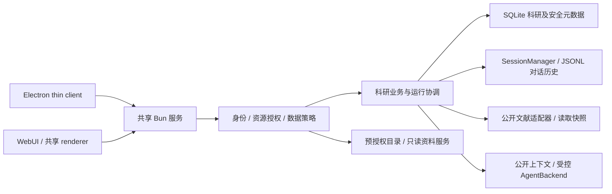

# BioEvidence 首版实现计划

版本：0.1.0

日期：2026-10-09（Asia/Shanghai）

状态：独立评判 agent 已于 2026-10-09 审批 PASS，进入 Tasks 阶段

依据：已确认需求摘要、Constitution 0.1.0、Spec 0.1.0（29 项 AC）；Clarify 已通过

2026-10-09 原方案已批准。当前T00–T16已完成阶段审批；T17仅本机checkpoint通过，原AC05生产公网未通过、AC22真实模型未验证；T18已交付公开源码开发预览，不等于生产部署或二进制发行。用户2026-10-21纠正目前尚未配置模型，4090/本地推理未部署或验收。最新远端CI本轮尚未核对；各阶段完成以实际evidence和任务状态为准，下文方案不是完成声明。最新UI/README扩展见第23节。

## 1. 选定方案

在 Craft monorepo 内增量开发：**一个 Bun headless 服务作为权威后端，Electron thin client 与现有 WebUI 使用同一 SessionManager、协议和共享 React 界面。** 科研业务和安全元数据新增模块，通过服务依赖注入接入原核心，不另写一套平台或 Agent 循环。

新账号、成员、资源归属、资料授权、策略、证据/报告修订、运行和审计采用事务性 SQLite。原会话 JSONL 保留为对话历史，不充当授权或科研修订的唯一依据。SQLite 具体适配器仅由 Bun 服务启动侧创建，再注入接口，避免 Electron/Node 或 renderer 静态导入 `bun:sqlite`。Bun 已内建该驱动并支持事务和 WAL，无需另加 SQLite npm 驱动。[官方文档](https://bun.com/docs/runtime/sqlite)

文献来源首选 Europe PMC；PDF.js 和 sharp 复用基线锁定版本。为开放全文 JATS XML 增加一个直接依赖 `fast-xml-parser` 5.11.2。原客户端 UI、预览、编辑器及主题继续复用。

未采用的替代方案：

- 从零重写或抽离全部内核：违反已选源码增量路线，并重复会话、连接、事件和 UI 工作。
- 为 Web 单独实现业务：容易产生权限与科研产物含义漂移。
- 只在页面隐藏资源或检查 workspaceId：不能保护直接 RPC、文件下载、事件回放和旧接口。
- 将安全元数据放进可编辑 JSONL 或多个无事务 JSON 文件：不能提供跨资源撤权、修订比较和运行提交的一致性。
- 自动回落模型、沿用任意 shell/路径/MCP 能力：违背已确认私有边界和受控公开调研契约。

## 2. 固定源码与隔离工作区

计划在 `work/bio-evidence` 准备独立派生目录，原 `work/craft-agents-oss-main` 与根 ZIP 保持原样。准备前检查目标；若存在用户文件或无法确认的工作，不覆盖、不清空、不重置。当前 chat 的根目录不是 Git 仓库，不使用假定的现有分支或自动迁移其他项目。

已核实的基线：

- 根包版本 0.11.4；ZIP 与源码目录的 1877 个文件逐文件 SHA256 全部一致，无变更、缺失或额外文件。
- ZIP SHA256：`ba48c941238e5fcf6ef6412c7fd53b30c863220ea81395e368013c38eb054871`。
- ZIP comment 声明提交 `50ffa143ab76e44c0e96ea785d03aa67cf942c50`；远端读取未成功，**仅记录归档声明，不写成上游已核实提交**。
- 没有 `.git` 或已安装依赖。新目录先记录初始源码快照与来源，再记录二开提交；不伪造上游历史。

将已批准需求/Constitution/Spec 与本计划按现有项目文档约定收纳到派生仓库 `docs/bioevidence/`；新增来源说明与验证记录。缓存、SQLite/WAL、JSONL 运行数据、密钥、下载工具、真实目录和 `.env` 全部排除提交。

BioEvidence 的进程包装在创建 Bun/SDK 子进程前设置新的产品目录及运行模式，使用现有 `CRAFT_CONFIG_DIR` 等兼容覆盖机制，但派生默认目录、名称、deeplink 和 appId 统一改为 BioEvidence。隔离覆盖测试、构建、preload、SDK 与应用，而非仅后端入口。服务器状态与客户端配置分别存放，不共用实验资料目录。

**首次执行前的隔离是第一批必改内容。** 基线 `bunfig.toml` 会 preload 网络 interceptor；`interceptor-common.ts` 在导入期硬编码并创建/轮转 `homedir()/.craft-agent` 日志，忽略目录覆盖。先用外部 Node/PowerShell 启动包装、无原 preload 的受控 bootstrap 配置及测试替身建立回归，再修正 bunfig、interceptor 和所有相关硬编码路径。BioEvidence 模式没有显式命名空间就拒绝初始化，不能回落到旧用户目录。没有证据证明导入安全前，不运行原 `bun test`、构建或 SDK preload。

初始化隔离测试使用本工作区内的 fake homedir/文件系统或读取拒绝替身，不能通过真实写入旧 Craft 目录来演示失败；不重定义用户全局 HOME/CODEX_HOME，不扫描旧凭据。全部后续命令经已验证的隔离 launcher 执行，继承环境按用途白名单化。

## 3. 模块边界与实际复用点

以下路径以派生仓库根为基准。“新增”为计划路径，“现有”为实际基线中已核实文件。

| 范围 | 计划改动与职责 | 基线证据 |
| --- | --- | --- |
| 新增 `packages/research-core/` | 纯 TypeScript 领域记录、错误、策略、结构校验、修订和运行契约；不导入 Bun/SQLite、文件系统或 UI | 复用 core/shared 现有类型约定 |
| 新增 `packages/server-core/src/bioevidence/` | 身份、资源授权、研究、证据/报告、受控资料和审计服务；依赖仓储/时钟/模型等接口 | `handlers/handler-deps.ts` 可注入服务 |
| 新增 `packages/server/src/bioevidence/` | Bun SQLite 仓储、迁移、启动配置、部署侧资料授予和初始化账号入口 | standalone server 明确以 Bun 运行 |
| 现有 preload 与新隔离 launcher | 首次执行配置、旧日志/配置目录封口、用途化环境与 SDK namespace | `bunfig.toml`、`shared/src/unified-network-interceptor.ts`、`interceptor-common.ts` |
| 现有 transport/webui | 解析可信身份、RPC gate、事件 gate、回放/断线处理及登录契约 | `transport/types.ts`、`transport/server.ts`、`webui/auth.ts` |
| 现有 RPC handlers | 所有通道分类，范围解析、列表过滤、资源读写授权或显式禁用 | `handlers/rpc/index.ts` 及 sessions/projects/workspace/files/sources/settings/llmConnections 等 |
| 现有 SessionManager | 科研运行挂接、严格连接选择、公开输入、取消标识和 JSONL 投影 | `sessions/SessionManager.ts` |
| 现有 shared agent/子进程 | public-research 配置、上下文裁剪、工具白名单、辅助调用与策略检查 | `agent/backend/types.ts`、`factory.ts`、`pi-agent.ts`、`core/pre-tool-use.ts`、`pi-agent-server/src/index.ts` |
| 现有共享 protocol | 新 DTO、频道、事件与 runtime 校验；新增方法同步到两端 | `protocol/channels.ts`、`events.ts`、`routing.ts`、Electron `transport/channel-map.ts` |
| 现有 JSONL queue/storage | 修正串行/flush、可恢复替换与 tmp 对账，接 SQLite 投影 journal | `shared/src/sessions/persistence-queue.ts`、`storage.ts` |
| 新增共享科研 renderer | 文献、证据、报告、运行、受控资料和账号/成员界面 | WebUI `App.tsx` 和 vite alias 复用 Electron renderer |
| 现有预览/编辑器 | 授权 source/file ID loader、证据页跳转、帧切换、修订冲突 | `packages/ui` PDF/Image overlays、ItemNavigator、Markdown/editor |
| 构建与品牌 | 新启动/test runner、依赖锁、Windows 桌面配置、服务/WebUI 组装、实际部署文档 | 根 scripts、`electron-builder.yml`、`Dockerfile.server`、`shared/src/branding.ts` |

## 4. 身份、资源范围与通道授权

### 4.1 用户身份

复用 `jose` 和现有密码检查模式。Bun 服务用 Argon2id 存密码摘要；Web 使用同源登录与受保护会话 cookie，桌面使用同一账号登录所得的用户会话凭据。签名或随机凭据都绑定服务端认证会话；具体 JWT 内容不作为权限的唯一来源。

认证会话在 SQLite 记录用户、到期时间与撤销状态，默认绝对期限 24 小时，后续可配置。每个受保护请求及事件交付检查当前会话、账号与资源关系。客户端携带的角色、userId、workspaceId 不能授权。旧共享 server token 不能访问科研资源。

桌面登录凭据由主进程/受控客户端配置保管，renderer 只取得必要身份与结果；Web 不把凭据放进普通 localStorage。模型/来源密钥复用既有可信后端凭据管理，在 BioEvidence 命名空间内保存，只返回遮罩状态。不更改全局 Git、系统账户或用户原 Craft 配置。

非 loopback 服务连接要求 TLS；复用当前 thin-client 的明文限制，移除远程连接中 `tlsRejectUnauthorized: false` 的无条件放行。Web 登录/WS 的 Origin、Host 与受信代理明确配置，不反射任意请求头。开发默认只监听 loopback。

### 4.2 业务范围

安全仓储记录个人空间所有者、共享项目负责人/成员、会话所有者及资源所属范围。原目录和 ProjectConfig 作为组织/存储定位，不能自行证明关系。

个人空间只列本人资源；共享项目按成员过滤。为原 workspace/project UI 提供当前身份的视图，不通过让用户访问整个他人 workspace 来实现项目共享。共享会话可读，执行/取消只允许其所有者。无归属旧记录不开放。

部署侧为用户/项目提供资料授予记录（rootGrant），包含经确认的根和允许范围；项目登记只消费已有授予，不能创建新的磁盘权限。平台管理账户不能在 UI 自授其他人的资料，不能将内部配置/凭据目录登记为研究资料。

### 4.3 通道与事件封口

建立完整的频道→动作→资源解析清单：匿名启动/登录、当前账户、项目资源、会话执行、研究产物、资料浏览、服务配置、客户端本地能力、明确禁用。未分类通道默认拒绝，新增 handler 没有相应规则时不能在科研 profile 上开放。

所有 legacy RPC，包括列表、文件、来源、settings、transfer、OAuth、自动化和分享都分类；不需要的首版功能在 profile 不注册或明确拒绝。不能仅保护新增 `research.*` 方法。返回列表与敏感结果前再次检查授权。

事件带用户/项目/资源范围，发送前重新检查当前成员和会话。旧已序列化回放缓存不能只按 workspace/clientId 重放；重新连接绑定账号，撤权后清除受影响缓存并停止内容交付。遗漏的科研结果通过持久化运行/产物读取，不能依赖有限环形缓存。

本地文件选择与 OS 对话框只发送到发起请求且身份一致的桌面客户端，不能回落到同 workspace 的任意桌面。Web 的文件选择使用浏览器已授权 File；桌面上传读取只限用户选择的文件，不能将客户端路径误认为服务器路径。

## 5. 领域记录、事务与兼容性

| 记录组 | 关键内容及权威关系 |
| --- | --- |
| users/authSessions | 密码摘要、启停、会话到期/撤销；权限由服务端查询 |
| spaces/projects/members | 所有者、负责人、成员与当前授权版本 |
| resourceBindings | workspace/session/source/artifact 与安全范围的可信绑定；没有绑定则拒绝 |
| rootGrants/materials | 部署侧授予、登记范围、只读入口及资料状态 |
| sources/snapshots/blocks | 授权范围、数据策略、来源/许可、内容指纹、读取覆盖、页/段落和版本 |
| evidenceRevisions/reportRevisions | 不可变修订、expectedRevision、证据引用、结构校验及绑定版本的人工审阅 |
| researchRuns/steps/intents | 所有者、选定连接、输入清单、步骤、租约、取消代数、产物与未完成副作用 |
| directoryIndex | 受控文件标识、相对路径、metadata、扫描代数和完成快照；不保存全套原图 |
| projectionJournal | 已提交会话投影的完整消息内容或不可变内容引用、顺序、operationId、校验和及待投影状态；按原资源授权，不是普通诊断日志 |
| audit/outbox | 必要审计、已提交科研事件及其资源范围；审计没有正文/密钥，事件按范围授权 |

单个服务实例是权威写入者；启动使用独立 BioEvidence 存储及实例锁，防止两个实例写同一数据集。SQLite 启用外键、WAL、短事务和参数化语句，不在事务里等待网络、模型或大文件解码。

更新授权、修订和运行终止状态使用条件写入：当前角色、expectedRevision、runId/取消代数都须满足。成功提交与相应 audit/outbox 在同一事务完成，提交后才推科研完成事件。

JSONL 保留现有格式与队列的接口基础，但必须修正实现，不能假定原 queue 的 flush 已有持久化保证。SQLite 是安全/研究业务权威；已提交消息投影内容进入受权 projectionJournal，JSONL 是对话历史视图。journal 保留能重建完整投影的消息内容或不可变引用，不只保存 operationId；普通审计不保留正文。

`persistence-queue.ts` 的 enqueue/debounce/flush 统一进入每会话串行链；flush 等待全部前序及当前要求的代数，写入失败向调用者传播。取消 pending entry 不等于完成持久化；只有真实成功且匹配投影校验和/代数，才确认已投影。

修正现有“先删旧 JSONL 再 rename”与 `storage.ts` 自动删除残留 tmp 的行为：完整临时文件写入并确认后使用不预删目标的可恢复替换；失败保留旧正式文件与新 tmp。启动先按 journal、校验和和代数对账，可用 tmp 则安全恢复，否则从权威 payload 重建。没有判断依据的 tmp 保留/隔离，不自动删除唯一副本。Windows/POSIX 文件替换差异以实际失败和重启测试验证。

跨 SQLite/JSONL 不是一个原子事务：研究提交与待投影内容先写数据库，之后 flush JSONL，收到持久化确认才标已投影。提交后投影失败显示待恢复，不回退已提交科研业务或假装对话已保存；数据库里没有的临时流式预览不标完成。投影与历史恢复不能用于绕过资源权限或给模型拼接未核对历史。

迁移版本显式记录，升级前备份受控状态。首次派生不自动读取原 Craft 用户资料。回滚使用旧代码与相匹配的备份，新数据保留；不以降级脚本盲目删除表或改写实验目录。

## 6. 文献与读取快照

### 6.1 Europe PMC

`LiteratureProvider` 的 search/record/openText 接口使用固定公开服务：关键词、cursor、pageSize 和取消信号，返回真实题录与错误分类。检索用 JSON core 结果，保留 provider cursor；开放全文只取对应 PMCID 的 OA XML，获取失败保留摘要层级。[官方 REST 文档](https://europepmc.org/RestfulWebService)

公开 HTTP 只访问适配器定义的服务和来源，参数以标识而不是任意 URL 输入。检查 HTTPS、重定向及地址范围；不把模型给出的链接当作可读取内网或本地文件的权限。查询/快照缓存按安全范围和策略隔离。

查询缓存默认 15 分钟；读取正文形成不可变 snapshot，刷新形成新版本。区分公开可读、实际已读及文章许可；不将 API 许可当成论文许可，不抓取受限全文或沿用已停的 PMC OA Web Service。公开交付仅放允许再分发的片段/合成样例。[开放获取说明](https://europepmc.org/downloads/openaccess)

2026-10-09 已以 PMID 37794110 只读调用实际检索 API，返回 1 条 ALFI 记录、正确 PMCID/DOI 及摘要。这只证明服务连通，不是本应用 AC-05 已实现。

### 6.2 PDF/JATS 与覆盖

复用锁定的 PDF.js 5.4.296，抽成页级 `PdfTextExtractor`，不复用当前“跳空页→拼接→截断字符串”作为完整读取结果。先按实际字节与页面数检查 Spec 的 25 MiB/100 页，逐页记录读取、无文本、失败与定位；混合文件保留部分覆盖。获取方式与摘要/全文/部分文本分开。

JATS 用 `fast-xml-parser` 5.11.2 保序解析，保留段落/章节标识和文本定位；禁止外部解析及实体扩展，限制输入、深度和节点。正文解析覆盖不包含图片像素判断，不可解析的表格/公式明确记录缺口。

snapshot 保存内容指纹、取得时间、许可和覆盖信息；生成输入记录实际使用的 block。来源失效后已有合法快照仍可回查，不能在回放时悄悄换成最新内容。

初始解析预算：公开 JSON/XML 最大 10 MiB、请求 30 秒；XML 深度 64、节点 100,000；PDF 单 worker、30 秒、文本总预算 5,000,000 字符。达到文本/结构预算时标明部分读取或拒绝解析，不截断后继续声明全文完整。参数由配置定义并在边界测试中验证。

## 7. 证据与报告修订

`EvidenceService` 只接受当前授权 snapshot/block 与合法定位；quote 从读取快照核对或选取。factSummary、quote、locator、evidenceRevision 和数据策略分开。机器检查使用明确的文本规范化与定位映射，不能把语义判断伪装成结构一致性。

`ReportService` 保存“主张→证据修订”的结构，Markdown 是呈现与导出。自动状态只表明结构校验；人工审阅有报告修订、操作者、时间与结果。新修订重置相关状态，旧记录保留并显示依据变化。

所有编辑带 expectedRevision。冲突返回当前修订信息而不覆盖，客户端保留待提交文字。报告生成先形成草稿，引用或片段不匹配时进入待核对，不让模型自己打“人工已审阅”标记。

Markdown 与 CSV 的服务端导出层携带状态、来源和读取范围，复用已有转义并补公式中和；前端禁执行原始 HTML/脚本和远程追踪内容。PDF/图像 loader 接收受权 sourceId/fileId，不接受任意服务路径。

## 8. 公开 Agent 与统一外发检查

新增 `public-research` 执行 profile，贯穿 BackendConfig、父进程、PreToolUse 与 Pi 子进程。模型使用现有 `pi` 官方 OpenAI 配置或 `pi_compat` 兼容配置；不另造一个 Agent SDK 循环。

请求前，服务端从当前授权来源构造 immutable InputManifest：来源/修订/block、读取覆盖、策略版本、研究输入声明、连接和使用范围。所有字段从可信仓储解析，不信任客户端“public=true”。私有/未知/混合或已污染历史拒绝整次模型操作；普通备注默认私有，公开输入/编辑须有明确声明与继承关系。

profile 不自动加载 project details、assets、MEMORY、其他会话、Skills/来源说明。每次执行使用受控的公开 run 目录与明确 resource loader，不指向项目实际工作目录或实验根；关闭全局/祖先 AGENTS 文档、插件/扩展及其他 SDK 自动发现。只传本次批准的公开上下文与有来源记录的公开历史，不从未知 JSONL/SDK 日志直接拼接历史。源头标记、来源内容或模型指令均不能修改权限。

Pi 的内置 read/bash/edit/write/grep/find/ls、任意网页及代理工具在此 profile 不注册。只提供受控公开文献和公开产物工具，调用前、读取内容前和返回模型前检查当前身份/范围。禁止隐式来源激活和不可控临时 Agent。PreToolUse 再作硬检查，ask/allow-all 不覆盖策略。

标题、摘要、压缩、queryLlm/call_llm、配置测试与其他辅助模型调用使用相同 envelope/出口约束。私有来源首次不创建推理执行；私有标题可确定性命名。公共会话未知 helper 没有上下文声明则拒绝，不放行“这是辅助操作”。

明确连接选择采用严格解析：所选 ID 不存在/失效/能力不足即失败；不落到 workspace/global。首版没有可信私有 LLM；把兼容接口取名“本地”仍不能读取私有内容。第三方 viewer、updateShare 与自动分享在服务端拒绝，正常项目共享和授权下载保留。

公开上下文使用可配置预算，初始最大 32,000 字符；片段选择结果及未使用范围明确记录，超模型能力时提示减少来源，不声称全篇已交给模型。输出按证据/报告结构验证，invalid JSON、未知引用和不匹配片段不会成为已校验内容。

**T13 接口收敛（2026-10-15，独立审批 PASS）：** 正式服务在 Bio namespace 懒初始化既有 CredentialManager，组装连接、公开输入、worker 与 Executor。配置通过 typed `listModelConnections` / `saveModelConnection` RPC；当前管理员配置、当前获授权成员选择，响应仅提供遮罩后的状态/模型视图，按当前权威版本重新核验。配置与创建者绑定，密钥用 UUID 暂存引用与 DB CAS 切换；加密文件采用同目录完整写入后替换，失败保留旧文件并失效缓存。崩溃后未引用密钥和管理员接管策略留运维收敛，不自动删旧活动引用。

模型输入按逐项 JSON 字符/字节预算早停，权限证明留 hash；每次 SDK 调用再对包含工具结果的完整上下文按所选模型窗口检查。worker 仅传固定安全错误码。Executor 返回未人工核对的结构化候选；T13 不公开裸 generate RPC，T14 从持久 intent/租约入口挂接它，并负责来源可证明的公开投影历史及结果保存。

## 9. 受控资料与资源预算

`MaterialsService` 使用 grant/rootId、opaque fileId、relativeDir、cursor 与 frameIndex。登记只接受预授予范围，并排除内部账户、凭据、缓存和状态目录；共享物理目录需独立授予，不能以宽父目录涵盖他人资料。

路径校验结合 canonical path、边界比较、父路径/链接检查与打开对象校验，拒绝 `..`、前缀相似兄弟目录、链接逃逸与跨项目标识。实验源只读；没有安全打开条件或检测到文件替换时拒绝/重试，不降级为任意路径读取。

目录按层级进行增量 metadata 索引，批次 200，默认单扫描任务；不递归解码或复制原图。已完成的目录快照按自然名称稳定排序，SQLite 游标分页每次默认 100/最多 200；索引中显示进度，目录变化让旧游标明确失效。首版预算默认每目录 100,000 项，可配置，超限明确显示未索引范围。

复用 sharp 0.34.5，扩展 metadata 的 TIFF 页数/单页信息和 page 选择。每次只读选中帧，缩略最长边 256、查看最长边 2048；源文件不写。初始预览预算：输入文件 256 MiB、单帧 50,000,000 像素、最多 2 个解码任务、5 秒处理时限；超预算提供 metadata 和明确状态。

原生解码选择独立、可终止的子进程，避免只终止 JavaScript worker 却留下原生处理；超过时限需证明进程退出和资源释放。传入数据只经受控 IPC/打开对象，普通 argv/诊断不含私有路径或正文。原文件下载使用授权只读流而不是整文件 base64；开始、打开及后续数据交付检查授权，撤权中止后续传输。缓存/索引与预览适用相同数据策略与访问规则。

用合成 PNG/JPEG/单页与多页 TIFF、有序帧和 10,000 文件目录验收；实际 4090 资料始终标为未接入，直到真实连接完成。无 GPU、训练或图像语义检索工作。

## 10. 运行协调、取消与崩溃对账

`ResearchRunService` 复用 SessionManager 的消息/事件与存储接口，增加持久化科研状态机：准备、获取/解析、生成证据、校验、生成报告与终止状态。会话同时一条有效运行租约；新提交提示已有执行，不走原 steer/queue 改写当前科研请求。

runId、stepId、inputManifest、operationId 和取消代数绑定所有 callback。提交前检查当前账号/项目权限、数据策略、连接、运行代数与预期修订，避免撤权或晚到响应写入。

取消先原子更新终止状态与代数，再 AbortSignal/forceAbort；不发后续操作，不提交晚到产物。客户端断连不取消任务；服务重启把未终止运行标中断，保留完成步骤/产物。

每次外部调用先记 intent，再执行；不在数据库事务内等待。重启发现已完成产物则复用；模型请求是否已完成不明时显示需明确重试，不能自动再收费或重放不明副作用。重试形成新运行并引用复用步骤，记录来源和结果。JSONL 对账同时核对 operationId、代数、完整 payload/引用与校验和；debounce 中 flush、写失败、替换中断和残留 tmp 都有明确恢复结果。

工作进程以已验证的运行所有者及当前账号/成员权限执行，不借客户端伪造身份；账号停用或成员撤销可中断受影响运行。客户端登录期限影响其后续请求/事件，不把断连等同于服务器任务消失。

### T14 实施细化（2026-10-15 独立审批 PASS）

- `startRun` 从此前尚未启用的占位参数收敛为明确的公开输入（模型、片段、证据、公开声明）、purpose、expectedRevision 与 operationId；新增按 session 分页的 `listRuns`，`getRun` 返回运行、步骤、固定输入清单、产物引用与安全错误。旧占位请求尚无可用生产行为，不接受缺模型/公开声明的隐式兼容调用。
- 使用既有 v1 `run_steps` / `run_intents` / 唯一活动运行索引及租约，不引入新数据库。事务创建 queued 运行及操作指纹；同 operationId/同内容重放返回同一运行，指纹不同拒绝。单会话只允许一条活动运行；模型 worker 全局并发 1，其他会话排队，不在事务内等待外部调用。
- 模型发送前持久化完整可信输入清单和 selected connection 指纹。Pi 循环中的每一次实际 SDK 发送都分配 attempt/call ID：在最终 payload 出站回调中经父进程检查并持久化独立 intent（绑定 run/generation/manifest/connection）后才允许发送；不能用 startRun 或整个 generate 的一条内存状态代替逐次记账。实际模型结束回执经同一绑定确认；网络中断、取消或崩溃留下任何未确认 intent 时均标不明，重启不补发。执行使用仅由运行服务建立的所有者执行上下文，持续核验账号、项目权限、来源策略与运行代数；它与客户端登录会话分开，断线/登录到期不自动取消。后台上下文只能来自已持久运行和本进程能力，不能由 RPC 参数请求或冒充。
- Executor 内部接受服务构造并冻结的 prepared input，避免在 intent 之后换一套来源或连接。通过候选校验后，在同一权威事务核验租约/代数、保存未人工核对的证据或报告修订、完成步骤/运行、写 outbox 与完整 JSONL 投影记录。模型生成内容保持 unreviewed；不覆盖用户已编辑的旧产物。
- SessionManager 增加受控科研投影接口，由正式 Bio 入口挂接现有 SessionProjectionService；无需初始化旧 workspace/automation。沿用既有 StoredSession/消息与原子文件格式。客户端只收到带范围的科研事件；outbox 发布表示元数据可读取，不等于客户端已持久保存结果，重连仍读取权威运行/产物。
- 取消先提交终止状态和新代数，再中止 worker；提交路径拒绝过期租约和晚到响应。撤权由当前检查与服务监测触发中断，不需要已撤权用户自行取消。停止等待所有执行退出；重启将未终止运行标为 interrupted，保留完成步骤，不自动重发不明 intent。显式 retryOf 产生新运行，已完成且当前仍授权、输入/连接指纹一致的产物可复用，避免重复保存或计费。
- 公开投影证明由权威运行完成记录产生，并关联固定清单、产物及完整消息校验和。未知 journal/SDK 历史仍拒绝；可信历史也不直接拼接进模型上下文。后续调用仍从用户本次选择的公开片段构造输入。会话历史、步骤和分页均限制累计字节预算。

首组行为测试为同一操作重放、不同操作争抢同会话、取消后忽略晚到响应；后续覆盖 DB/JSONL 窗口、写盘故障、撤权、登录到期、重启不重发、重试复用、两客户端事件和投影真实性。T14 完成后再做 T15 界面。

2026-10-16 实施收敛：prepare 保存完整冻结 modelInput；model-result 单独持久化，以便产物事务失败后明确重试复用。已完成运行的重试引用原产物修订，不覆盖后续人工 head。新增 covered 投影状态，要求可信完整快照来源、已确认落盘及前序消息逐字前缀证明，保留每快照的物理回执。启动/周期维护按当前权限分批恢复文件，撤权保留 pending；共享 renderer adapter 只因事件或重连重新查询，不重发模型任务。停止及部分初始化失败逐项完成资源清理后再统一报告失败。最终证据及审批见 T14 阶段记录；这些收敛不表示 T15 界面或公网模型已经验收。

## 11. 双端界面与启动配置

现有 WebUI alias 和 API adapter 复用 Electron renderer；新增登录/项目视图及科研页只实现一份。新方法同时更新 shared DTO/events、CHANNEL_MAP、ElectronAPI 和 Web adapter，运行时输入仍校验。

页面分为论文选择/读取范围、证据表/定位、报告编辑/状态、运行进度和私有资料目录/帧预览。复用原主题、预览、DataTable 与编辑器；本地化遵循现有 locale 约定，新增功能不再引入第二套 UI 库。

身份切换/撤权清除当前资源视图和缓存访问，待提交草稿按本人身份隔离；另一账号不能读到上一个人的草稿。Web 的私有预览只通过认证来源 loader，桌面不从服务器路径猜本地路径。

开发及首版受控服务使用同一端口（默认 9100）承载 RPC 与构建 WebUI；不沿用未被源码读取的 CRAFT_WEBUI_PORT=3100。Electron 产品默认 thin-client；没有连接配置显示服务连接/登录入口，不静默启动未受控原生后台或读取原 Craft 数据。

### T15 实施细化（2026-10-16，独立审批 PASS）

`/root/t14_independent_judge` 已批准以下技术细化进入实施；实施验收仍须分别检查 Spec、质量与真实双端运行证据。

T15 局部审阅补充（`/root/t14_independent_judge` 独立审批 PASS）：Web 同源标签页共享 HttpOnly cookie。登录/当前账号响应提供不可用于认证的 sessionBinding；Web WS upgrade 查询参数及配置/当前账号/上传/注销请求携带预期绑定，服务端与实际 cookie 解析出的 authSessionId 比较，不匹配拒绝。携带绑定的注销只撤销该会话，不发送清 cookie 响应，避免迟到注销清除另一标签页新 cookie。连接每次重建仍固定该绑定，避免新主体数据写入旧主体草稿。桌面 bearer 仍只在主进程；sessionBinding 不替代凭据或授予权限。控制器 dispose 后永久关闭，排队及晚到 restore 不得重连。仍须真实测试证明问题关闭。

- 当前旧 App 启动会调用被科研服务禁用的 legacy workspace/session API，不能直接挂科研页面。新增一份共享 BioApp 及论文/证据/报告/资料/运行面板，Web 与桌面都挂这份 renderer；复用既有 UI 控件、DataTable、主题 token、Textarea/编辑控件及 i18n，不增加 UI 框架或测试依赖。保留原 Craft 页面源码作为来源，Bio 启动不初始化其业务流程。
- 在既有 CHANNEL_MAP/buildClientApi/ElectronAPI/Web adapter 增加完整 typed research namespace、科研事件和账户接口。共享业务页面只调用这些接口。模型连接、数据范围与公开声明在发送前可见；T14 state adapter 只因事件/重连读权威状态，未知模型请求必须明确新操作才能重试。
- Web 账户继续使用同源 HttpOnly/SameSite cookie；不把登录 token 写入 storage。共享登录组件在未登录/到期时工作，登录成功后建立既有 WsRpcClient。账号或项目/会话切换增加 generation 并清理旧视图、订阅、预览对象 URL 和异步结果；未提交文字仅在本窗口内按已认证账号及资源隔离保留，有界且不发送模型、不进入通用缓存或诊断。修订冲突保留本人文字，读取最新版本后由用户决定如何形成新修订。
- Electron 使用专门的 Bio thin-client main/preload 入口，复用 namespace bootstrap、既有 WsRpcClient 和 API proxy；受控构建输出 `bio-main.cjs`/`bio-preload.cjs`，renderer 入口为 `bio.html`。主进程不启动旧 embedded server、SDK 或 OAuth/browser/shell capability。每窗口账户及 bearer 仅保留在 main 私有状态，IPC 从真实 sender/mainFrame 推导窗口，不接受客户端传 webContentsId/actor；只允许 typed research 请求和必要的账户、PDF 上传、受控导出及连接操作。main 在异步返回和事件转发前重新核对窗口/账户代数，退出销毁连接和未完成访问；renderer 不能读取 token 或任意文件。
- 桌面无配置时仅显示 HTTPS/loopback 服务地址与登录表单，默认 thin-client。显式连接时验证 origin，不接受重定向或远程明文地址。只持久化非秘密服务地址；导航/新窗口和 IPC sender 受本产品页面边界约束。本机 PDF 由用户文件选择动作提供，最大 25 MiB，再经已认证 main 发固定上传路由；预览使用授权 RPC 返回的所选图片字节，不从服务端路径读取本机文件。导出只接收已校验产物 DTO 并由本人窗口确认保存，不暴露通用 read/write/shell 桥。
- 增加同端口科研 Web 静态适配器和认证 `/api/config`。静态根仅由受信任启动代码提供，不是 RPC 参数或任意服务文件夹；构建生成产品 marker/资源清单，服务仅提供该清单内 index 与静态资源，realpath/符号链接/路径遍历检查及 MIME/CSP/no-store 明确，排除配置、日志、目录浏览和任意文件。`/login` 进入共享 BioApp；不复用旧共享 token 登录页。配置返回已认证主体的非秘密连接信息，不提供旧 workspace 配置。完整发行包及部署位置仍在 T16 收敛，T15 先验证实际源码服务承载构建 UI。
- 现有读取 API 缺少 UI 重连后的目录入口，增加只读 typed `listSourceSnapshots` 与 `listArtifactRevisions`，分别从当前授权 source/产物 family 绑定分页读取有界摘要，再用已有 getSnapshot/getEvidence/getReport 读选中项。每页不超过 100；请求与响应都核对原资源、作用域及权威结果，不接受客户端 scope/owner。不会用 renderer 临时缓存充当持久历史。
- 配置者编辑连接时需要完整非秘密 scopes/model/API 配置，新增仅当前配置所有者管理员可读的 `getModelConnectionConfiguration`；严格省略 apiKey/credentialId。沿用既有保存 CAS、加密 KeyStore 和当前管理员校验，不因编辑当前项目连接而悄悄丢掉其他已授权范围。账号创建继续使用现有受控管理员 CLI，项目成员管理使用既有 RPC。
- 论文面板支持真实检索状态、公开/默认私有 PDF 导入、来源元数据与冲突状态、读取覆盖、按 PDF 页/JATS 段定位文本和选取 UTF-16 引用。证据表/报告编辑展示结构状态与人工核对的区别、来源及依据修订变化；保存形成新修订，显式人工核对沿用后端规则。历史可按 family 分页查看，导出保持引用与状态。来自资料的文本均以安全文本/受控编辑方式呈现，不执行原文 HTML 或自动加载任意外部图片。
- 私有资料面板仅选择已授权 grant/目录，浏览分页索引、按需索引/文本关键词查询/批注及所选帧预览；预览失败、预算、离线和帧范围有明确状态，切换回收旧图像 URL。不会把目录、备注或项目记忆自动送入云端。未接入真实 4090 数据时标为未验证，不新增训练或本地推理功能。
- 模型管理仅对当前管理员显示；所有人只选择自己范围内启用连接及其明确模型。无连接仍能手工整理证据/报告。私有或混合会话阻止云端按钮，清楚说明新建公开会话的路径；问题/片段/证据及公开声明由用户明确选择，发送后可查看实际冻结输入清单。运行页面显示取消、明确重试、unknown、文件恢复和 covered 的实际状态，不把零默认 usage 当实际零费用。
- 新文案沿用现有 locale 机制；中文/英文校对，其余语言新增键采用明确英文回落，保留 parity/sorted 检查。业务面板拆文件，状态控制器可单测，避免把所有逻辑放进旧 App 或单一大组件。
- 实施依次验证：只读发现接口及连接配置授权 → 跨端账户/typed bridge/静态资源边界 → 状态控制器和草稿/冲突隔离 → 页面组件 → 构建及实际浏览器/Electron thin-client。承接 T14 的 GET 切换/分页/2 MiB 拒绝测试；再覆盖三个账号、两个项目、断连/撤权、晚到响应、私有输入阻止、文本注入、PDF/图片与导出。实际 UI 验收使用隔离服务和明确合成资料；SDK/公网模型、真实实验数据与完整包装分别记录，不用截图或 mock API 冒充真实界面链路。

## 12. 依赖、运行时和包装选择

| 项目 | 决策 | 依据/范围 |
| --- | --- | --- |
| Bun | 可复现主线固定上游 CI 的 1.3.10，在项目工具目录准备，不改全局；本机 1.4.0 可作补充检查 | 原 Windows 打包下载 1.3.9 与 CI 不同，须统一记录和修正 |
| Node/Electron/TS/Vite | 保持基线锁定版本，Node 本机 24.13.0；Electron 39.2.7、TS 5.9.3、Vite 6.4.1 | 不趁二开升级无关依赖 |
| SQLite/jose/密码 | bun:sqlite 内建；jose/Bun.password 基线已有 | Bun adapter 启动侧注入，业务接口跨运行时 |
| PDF | pdfjs-dist 5.4.296、现有 react-pdf/UI 复用；新消费模块直接声明同版本 | 当前已有锁定版本与提取/预览，不新增 Python |
| 图像 | sharp 0.34.5 复用并扩展接口 | 基线 server-core direct 依赖，支持 TIFF 指定页 |
| XML | **新增 direct fast-xml-parser 5.11.2（MIT）** | 基线只有 AWS 传递旧版本，不能偷用；为保序 JATS 解析独立声明/pin |
| 其他 | 不新增数据库驱动、UI 框架、训练库或系统级工具 | 类型/运行时校验沿用项目模式，新增领域逻辑不依赖 SDK 内部私有 API |

XML 版本及许可已于 2026-10-09 通过官方 registry 核实；integrity 为 `sha512-R9iDuNrQYeQut46cn2r2wHKn4HYzVDvDm5J1wW+koZewykv0yuO2HChTYeZtrULyHIDM9cj9TUXloCsueCQUog==`。[固定版本元数据](https://registry.npmjs.org/fast-xml-parser/5.11.2)、[版本源码](https://github.com/NaturalIntelligence/fast-xml-parser/tree/v5.11.2)

锁文件只作已批准新增包/直接依赖的必要更新，不批量升级。增加解析依赖的替代是仅题录/摘要+手工 PDF 全文，不自动解析 OA XML；本计划推荐前者以完成更自然的检索到全文流程，需用户确认新增依赖。

修正包装入口：

- 根 `build`/`release` 指向不存在脚本，不作为完成证据。
- root `test` 的 `find` 与 shell loop 另用跨平台 runner 等价覆盖 `.isolated.ts`，不以普通 `bun test` 替代全部覆盖。
- root `webui:dev` 会杀端口占用进程，计划不用；使用分包 Vite 或自有启动器，只管理本次启动的 PID。
- `electron-build-main.ts` 当前读取根 `.env` 并把 Slack/Microsoft OAuth secret 及 Sentry ingest define 编入 main.cjs；在首次普通桌面构建前移除秘密 define 和服务 `.env` 加载。客户端构建环境只接收明确的非秘密构建元数据，遥测 define 固定关闭。运行时服务秘密和构建环境分离，不以“发布前扫描”替代源头封口。
- 用合成的 OAuth/API/服务秘密同时放入构建输入与运行配置，验证 main/preload/renderer、sourcemap 和包装文件均不含标记，且无遥测请求；只输出是否命中和文件名，不打印秘密值。
- Dockerfile.server 引用归档不存在的 manifests，需按实际 workspace 修正；Linux 服务/WebUI 包明确包含构建 UI、子进程和依赖资源，不能只构建一个 CLI。
- 现 `server:build` 只支持 Linux/macOS，Windows 本机先以 Bun 服务启动验收，不假称 Windows 原生服务分发已完成。Windows Electron 沿用实际 build/dist 入口并验证资源与用户登录。
- 新产品名/appId（拟 `com.gtdd123.bioevidence`）、HTML、logo/icon、deeplink、更新/分享地址统一；原许可证与 NOTICE 保留，未授权上游更新和遥测关闭。

## 13. 验证策略与命令

实施一项任务一个 Red→Green→Refactor 周期；先运行能证明缺失行为的最小测试，确认是预期行为失败，而非环境、导入或错误断言。准备源码/工具和普通文档/品牌改名使用检查与现有回归，不为低影响修改编造镜像测试。

安全与跨模块测试：首次 preload/SDK 命名空间与假旧目录标记、构建秘密输出、三账号、两个项目、伪造标识、旧 token、越权登记/链接、角色变更、事件回放、helper/通用工具出口、严格模型选择、SQLite/JSONL 写失败/flush/替换/重启、晚到响应与修订冲突。模型/网络/时钟用确定性替身，私有内容带合成标记并观察所有出口；不固定整段自然语言答案。

解析测试：真实可公开片段+自制 PDF 页、混合/纯扫描、加密/坏文件、尺寸/页数与覆盖；JATS 属性/顺序/实体/预算；PNG/JPEG/TIFF/帧、大目录按需读取、超预算和坏文件；导出公式中和和 renderer 非执行呈现。

以下为**预期未来逻辑命令，未执行**，在新派生目录用固定 Bun、已验证的隔离 launcher 和构建环境运行。表中的普通命令不是在修复前直接运行的指令：

| 验证 | 命令/方式 |
| --- | --- |
| 安装前隔离回归 | 新隔离 launcher + neutral bootstrap 配置，验证 preload/硬编码路径和 SDK namespace 配置契约；不加载未准备的 SDK，不读取真实旧目录或秘密 |
| 未改依赖基线 | `bun install --frozen-lockfile`；仅在首次隔离完成后记录锁定 runtime 下安装及原有检查 |
| 安装后安全回归 | 实际 SDK 导入隔离与合成秘密的构建 Red/Green；通过后才运行普通 SDK/应用/桌面构建入口 |
| 已批准依赖更新 | 仅针对本计划包修改生成 bun.lock，之后 clean install 使用 frozen lock |
| 根核心类型 | `bun run typecheck:all` |
| Web 类型补充 | `bun run webui:typecheck`（根 all 未包含 WebUI） |
| 科研新包/测试 | 拟新增 `bio:typecheck`、`test:bio`，覆盖领域、服务、transport 与 renderer |
| 原有回归 | `bun test`、跨平台 isolated runner、`bun run test:shared:all` |
| Web 构建 | `bun run webui:build` |
| 子进程构建 | `bun run server:build:subprocess` |
| Windows 桌面构建 | `bun run electron:build`，之后实际 thin-client 启动与必要 dist 资源核对 |
| 受控服务启动 | 现 `server:start` 的实际入口，新 `bio:server` 包装建立命名空间与 profile |
| 端到端 | 服务进程+两个客户端身份，浏览器 UI 与实际 Electron thin-client 场景；重启、撤权、取消与导出 |
| 真实公开服务/模型 | Europe PMC 少量公开查询；官方及兼容模型配置后的 smoke，记录 model/状态但不记录秘密 |
| 交付检查 | 许可证/品牌/源码来源/忽略规则/待提交内容/新增贡献与未验证 AC |

开发验证完成后才扩大到完整回归；遇原有基线失败先分别记录与定位，不能把无关失败记作任务 Red、关闭检查或偷偷变更原范围。

## 14. AC 与计划模块覆盖

| 模块/场景 | 对应 AC |
| --- | --- |
| 启动/preload/构建隔离、Auth、ScopeResolver、RPC 与 event gate | 01–04、17、23、24、28、29 |
| LiteratureProvider、snapshots、PDF/JATS | 05–09、19、27 |
| Evidence/Report 修订、定位、导出 | 10–13、23、27、29 |
| Materials/grants/index/frames | 14–18、20、23、29 |
| PrivacyGuard、public Agent、helper/连接/分享 | 07、19–23、25、27 |
| ResearchRun、JSONL/outbox 对账与双端 | 24–27、29 |
| 品牌/启动/文档/公开仓库 | 18、22、24、28 |

拟按隔离副本及 neutral 首次执行→preload/SDK namespace 配置契约回归→隔离环境内安装锁定依赖→实际 SDK 导入与合成秘密构建 Red/Green 封口、普通基线回归→领域与仓储/JSONL 修复→身份/授权→资料与文献→证据/报告→公开运行及双端→包装/端到端/公开交付的依赖顺序拆 Tasks。构建缺陷的 Red 只在无真实秘密的合成测试沙箱中执行，普通构建须等封口通过；安装过程不能顺便运行未验证的应用/构建入口。这里是集成顺序，不是已批准的任务清单；Tasks 将逐项给出允许文件范围、输入/输出、依赖和验证证据。

## 15. 风险、未验证项与收敛

| 风险 | 处理与验证边界 |
| --- | --- |
| 上游多入口权限和缓存 | 所有注册 channel 分类、default deny、event/replay 绑定主体；完整负向清单不漏 legacy |
| Agent 自动上下文/默认工具/辅助模型 | public profile 从父进程到子进程；不能只加 prompt 或附件过滤；多出口观测 |
| 两种存储与原队列不保证持久化 | flush 传播失败、完整投影 journal、非预删替换/tmp 对账，再结合 intent/取消代数；不明副作用不自动重放 |
| 图像原生解码与 PDF runtime | 页级服务与可终止边界，预算/坏输入；基线库存在不代表已跑通 |
| 源码/工具链/preload/构建秘密 | 首次执行前封硬编码旧目录与秘密 define，隔离 env；固定归档/实际入口，不声称未运行脚本成功 |
| 真实模型/实验目录 | 缺少配置时保留未验证 AC；不接私有服务器或借替身冒充实际效果 |
| GitHub 新仓库和推送 | 连接器没有建仓库接口；交付时用已授权网页/标准 Git 路径并核实身份与写权限 |

未验证事项仍为上游远端提交真实性、完整交付回归/包装、真实模型/4090 与目标仓库写入。固定 runtime 安装与安全构建已有 T02 记录，但原 Windows 基线尚未全绿。公开来源检索 API 已只读核实，应用集成尚未实现。

回归/审阅结果若显示接口或预算需要改动，先判断是否改变 Spec 行为；纯技术选择更新 Plan，行为/权限/依赖实质变化回到对应已批准文档处理。最终证据逐条关联 AC，不能只提交一张运行截图。

## 16. 计划确认事项

用户授权独立评判 agent 代替逐份人类审批后，评判者已明确批准整体方案、direct `fast-xml-parser` 5.11.2（MIT）、项目内 Bun 1.3.10、独立源码副本及首批修复。其余直接依赖复用基线版本，工具准备仅在项目目录内，不作系统级安装。

Tasks 已于 2026-10-09 独立审批通过，并按用户授权实施。后续文档和阶段修订继续交独立评判，通过后直接执行，不再逐份请求人类确认。

## 17. 计划审阅记录

2026-10-09 已完成范围/架构、文献/解析、基线/启动/构建三类独立审阅。发现的 JSONL flush/替换/tmp 恢复契约、Bun preload 原目录副作用及编译 secret 出口，均已写入实际修复范围和验证顺序并定向复核；当前没有遗留的计划文档阻断项。首次 namespace 检查与安装后实际 SDK/构建秘密回归已分别列出，避免前置关系混读。

上述为 **2026-10-09 初次计划审阅时**的状态：当时只确认方案的可审阅性和规格一致，真实修复、安装、运行、测试及构建尚未执行。2026-10-10 当前实际进展见 T02 evidence 与第 18 节，不将历史状态作为当前结论。

2026-10-09 `/root/independent_judge` 给出 **PASS，无实质阻断，授权推进 Tasks**，并独立核对 XML 官方版本/许可/完整性。此结论遵循用户已更新的审批授权，不虚构真实环境或测试完成。

## 18. T02 基线收敛与后续硬门槛（2026-10-10，独立审批 PASS）

T02 的安装、SDK 隔离与构建秘密门槛已有实际通过证据；完整原回归仍存在 Windows 基线失败，不写成全绿。T02 新引入的 namespace/构建回归和未归因失败必须解决后才能进入 T03。已归因原基线问题只有经独立评判批准、明确责任和关闭期限后才能转入对应任务。

| 待收敛组 | 已观察原因与影响 | 最晚关闭门槛 |
| --- | --- | --- |
| 模式权限 Windows 固定路径夹具 | 14 项引用不存在的 C:/Users/test、Balin 等目录；现有 realpath ancestor 检查拒绝虚构根，不能放松路径保护使测试通过 | **T13 开始前**改为真实 owned 临时根，保留全部原 allow/deny 断言并定向复验；公开科研 profile 同时禁通用 shell/文件写入 |
| Windows 服务退出 | 原 smoke 用 Bun 子进程 kill(SIGTERM) 期待 POSIX graceful exit；当前平台强制结束不能证明 flush/退出成功 | **T16 完成前**实现并实际验证 Windows 可用的受控退出机制及持久化完成；不得仅接受现有退出码 |
| Windows MCP 缺命令诊断 | 原 SDK stdio 在 Windows 经 shell 执行不存在命令，返回 Connection closed 而非结构化 ENOENT；拒绝连接成立，但错误分类不准确 | **T16 完成前**确保不存在命令有清楚类别与诊断，保留原失败及消息断言；不新增公共科研 MCP 出口 |
| Python 文档工具 smoke | 原归档没有 win32-x64/uv.exe，PATH 无 uv；实际 0 tests/8 setUpClass errors，不计通过 | **T16 完成前**按交付支持范围准备固定运行时并复验必要工具；不依赖的旧工具必须明确标为不支持，不能假报通过 |
| 原 CI / 包装入口 | 原检查脚本缺文件，旧包装/发布脚本已关闭危险 dotenv/secret 出口，不能当作可用交付入口 | **T16 完成前**替换为受控的真实 CI/Windows 包装命令，执行并记录；不使用上游发布目标 |

RPC 错误交付必须在 T06 前收敛，模型附件/连接运行时必须在 T13 前收敛，BrowserPane 必须在 T15 前收敛；当前定向修复已有通过记录，后续不能破坏。T17 必须重新运行全部交付支持范围的回归，关闭遗留阻断，并逐条记录 AC 和真实环境未验证项。此表是收敛责任，**不是测试豁免或交付完成证明**。

## 19. T15 实施收敛记录（2026-10-17，独立审批 PASS）

共用 UI、专用桌面入口、只读发现 API 和同端口有界静态资源已按第 11 节实现。角色能力逐操作对应服务端授权；listSpaces 成功移除项目或改变角色也显示固定权限提示。窗口草稿按 origin/account 隔离、4 MiB/100 项预算，满额明确拒绝而不淘汰旧稿；运行只有在冻结提交成功保留后才发送。私有批注草稿保持原 baseRevision，新修订不会自动覆盖或重基，明确对照合并/放弃才切换基准。

独立评判已顺序批准主体及追加修复 Spec/代码质量、四文档一致性和 T15 阶段。真实浏览器和 Electron39 薄客户端使用正式服务/业务与合成资料，模型边界为测试替身，不能替代 T16 包装、T17 公网模型/文献验收或真实数据接入。授权推进 T16，详情见 evidence/T15-shared-ui.md。

## 20. T16 实施收敛（2026-10-20，独立阶段 PASS）

运行与交付细化见 `T16-DELIVERY-PLAN.md`，实际命令与限制见 `evidence/T16-delivery.md`。采用独立 Bun 服务运行目录和未签名 Windows x64 Electron 便携目录；没有 Windows 原生服务 exe、安装器或 OS 协议注册。源启动仍必须经 launcher；正式客户端由受信 bootstrap 在加载业务代码前明确建立独立产品 namespace，过滤继承秘密和钩子，不回退到 Craft 用户目录。打包包含真实 worker/PDF.js/sharp/Pi 资源和版本依赖闭包，并已在仓库外运行目录执行合成资源检查。

PLAN18 的旧单共享 token headless smoke 保留为继承历史，不放松 Bio guard。由独立评判批准的等价 Bio 入口 smoke 验证真实账户令牌、旧/错误/短 token 拒绝、无账号和错误配置，以及正常/EOF/监督异常/超时失败与资源关闭；不据此声称全部原 Craft tests 通过。旧 Python/uv 套件明确不支持。新的 CI 验证入口只代表声明的 Bio 范围；尚未在 GitHub 执行。Docker daemon 不可连接，容器/Linux 仍未验证。

原有 Windows/MCP/CI 责任按本轮声明的支持范围经 T16 独立 Spec、质量及文档/阶段审批关闭。T17 的生产 Bun 公网文献、真实模型和完整 AC 门槛不变，GitHub 交付仍留在 T18。

最终统一科研318/0、类型/构建/资源 exit0，后续 bootstrap 与真实 launcher 的祖先目录重定向先写入问题经 Red→Green 修复、最终 Node36/0；MCP8/0。最终运行目录移出仓库后验证五类资源、账户业务与实际服务登录/停止/再建账号；最终桌面包仅加入测试包装器的副本验证双窗口、实际文件上传/帧/导出。合成密码读取器与 chooser 替身边界明确，模型请求为0。已知秘密及合成标记扫描无命中，但不是穷尽审计。独立评判 /root/t16_release_judge 已顺序批准 Spec/代码质量/文档一致性及 T16 阶段 PASS，授权本地提交后进入 T17。

## 21. T17 本机验收进展（2026-10-20，阶段未完成）

T16本地提交6243b25。既有统一验证补齐Bio公共profile、密钥原子替换、JSONL持久化与队列，以及双端/纯领域/包装脚本检查；本轮435/0、Node36/0、类型/构建/资源exit0。AC18空目录增加成功空状态，loading/error不误示未接入；AC27采用Spec允许的真实公开PDF导入路线，经实际IPC和实际Web页面核对同修订，不依赖真实模型，也不将该路线替代AC05/22。重复同快照读取的内存合成基准已观察175–438ms和341188KiB进程峰值，单操作预算缓存优化列P1，不能推广到真实大规模数据。

用户明确只在本机验收且目前无可用模型连接。生产默认EuropePMC因DNS198.18.x.x被保护拒绝，未改系统DNS/代理/TLS，也未借用宿主密钥。AC05/22仍未满足，T17全阶段与T18发布门槛保留。实际命令、29项对照、真实/替身和截图限制见evidence/T17-acceptance.md。独立评判/root/t16_release_judge已对当前修正与状态文档顺序给出规格/质量/文档一致性PASS，批准本地checkpoint，不代签T17整体完成或提前T18发布。

## 22. 用户授权公开源码预览（2026-10-20）

用户最新明确要求“给这个项目README做好看点，然后都发到github上面吧”。按此新授权推进README展示与`gtdd123/bio-evidence`公开源码交付，不再等待暂缺的模型连接才公开源码。此次是标明限制的0.1.0开发预览，**不把T17标为全PASS，也不宣称生产可用或发布已验收安装包**；第21节与T17记录保留为对应历史结论。

README增加与实际品牌一致的SVG横幅、静态状态徽章、真实合成界面截图、能力/继承归属、快速启动、数据流与验证状态。高级TLS/目录授权引用既有独立部署说明。截图只使用已核对的合成账号/项目，不提交真实资料、简历、凭据、模型key、论文全文、node_modules、.tools或.runtime数据。

公开前核对完整待推送Git历史/文件清单、已知秘密和高置信敏感模式、大文件/来源许可、文档相对链接及资产；由独立评判检查README和当前发布范围。使用已有GitHub身份创建公开空仓库，保留本地派生历史，不覆盖已有远端内容；通过标准Git认证推送，再核对远端commit和README/资产可读。源码发布与真实模型/EuropePMC公网验收分别报告。

## 23. 真实演示与工作台扩展（2026-10-21，独立审批 PASS）

以 SPEC UI01–UI06 为准，依次实施 T19–T22。当前基线 ec368ad 主要修改生产发布文案，没有提供相应新的模型/文献/GPU/容器执行证据；保留该提交历史，最终展示只按可核实的记录表达。用户现已明确模型尚未配置，本轮不读取或借用宿主模型凭据。

1. **资料三栏：** 复用 MaterialsPanel 现有授权、索引、选帧与批注 API，调整组件区域与响应式 CSS。文件浏览、预览、批注分区；首帧按需加载，帧请求与对象 URL 按请求版本清理，旧结果不能覆盖新选择。继续按目录分页，不新增全盘扫描。保留原空状态用于未接入场景，展示截图取实际有数据的场景。
2. **模型与执行模式：** 连接契约新增可选部署标签，缺省 Cloud，官方提供方始终为 Cloud；兼容接口可标 Self-hosted/Local HTTPS，继续要求 HTTPS，标签不放宽公开输入策略。会话级模型/模式草稿由共享控制组件提供，传入 RunsPanel 冻结提交；登录前和没有会话时显示未选择/禁用原因。运行记录没有模式的兼容语义保持旧自动受限工具行为，不改变既有请求幂等指纹；新界面明确发送 Ask。
3. **服务端工具门槛：** 在现有 Pi beforeToolCall 与父子进程检查协议中添加有界工具请求/完成事件。每次调用先校验白名单、参数及当前授权，再依据冻结模式拒绝/等待批准/自动允许；执行前和返回后仍重查公开上下文。只开放 get_public_block/get_public_evidence。使用现有 run_steps 保存最多16次工具请求和决定/结果，不保存完整工具输出或密钥；RunView 返回有界摘要。新审批 RPC 仅运行发起者可决策，绑定 run/generation/requestId；超过45秒拒绝，取消/撤权/重启不自动恢复待审批。子进程已有总时间预算继续有效，不无限等待；审批失败不能发出后续模型请求。SDK/工具事件持久化失败须失败关闭。
4. **轨迹与引用：** RunView/WS 继续作为状态权威；提炼纯函数将实际持久步骤/模型收据/工具事件转换为有序轨迹，供会话紧凑卡片及运行详情复用。报告读取界面与编辑表单分开呈现，引用按钮定位具体证据修订；新只读 CitationReader 读取同一快照块并验证精确偏移、页码和原文，失配显示待核对。使用文本高亮，明确不增加 PDF 图像坐标渲染器或新解析依赖。
5. **真实演示：** 从官方公开样例来源核验许可，准备12页普通 TIFF（若由多通道Z栈派生，明确写明选取通道/Z层而非伪称时序）。样例数据只放被忽略的演示目录；管理员通过 material-grants.json 授权，应用正常注册/索引/预览/保存批注。只提交许可允许的界面截图/GIF与来源说明。真实模型由用户在产品中配置，通过公开材料最小调用验证后录屏；不可用时明确记录，不伪造。GIF编码仅使用实际捕获帧，不生成虚假界面；必要等待压缩在 README 注明。

**验证：** T19 的请求乱序/切端销毁、批注 CAS 与预览实际流转；T20 的默认/旧记录兼容、Safe零工具、Ask批准/拒绝/超时/取消/撤权/重启、跨账号拒绝、未知工具/私有上下文各模式硬拒绝；T21 的真实事件排序、失败/取消不假完成、引用精确匹配与失配/缺失/越权清屏。先执行有意义的定向 Red→Green，再运行受影响回归、类型、lint及双端构建；最终实际 GUI 与受控服务端验收。文案/样式不添加镜像测试。应用依赖不新增，公开素材只作为数据，不运行下载代码。

**兼容与回退：** 既有连接/请求缺新增字段时保持原语义；新增事件由共享契约覆盖两端，旧客户端遇到新API必须明确报错。无需新增数据库表或 schema 版本，复用有界 JSON payload；原持久化请求指纹不能因解析默认字段而改变。界面默认值变化不追溯重写历史运行。回退先停止活动执行，保留历史事件供新版本读取；不删除资料或重写已提交历史。
